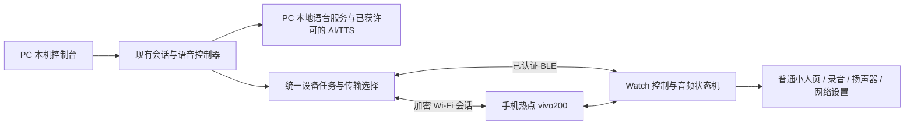

# StopWatch Wi-Fi / BLE 自动切换与设备语音对话 PRD

- 文档版本：v1.0.0；日期：2026-10-04（Asia/Hong_Kong）。
- 状态：需求已确认，规划交付；产品尚未实施，网络、性能、耗电及设备行为尚未实测。
- 执行配套：[Sol·高目标模式任务书 35](35-WiFi与BLE及Watch语音Sol高目标模式任务书-v1.0.0-【codex】.md)。
- 规划目标版本：电脑端 v0.20.0-dev；Watch 固件 v0.11.0-dev。只在实施时更新源码版本，文档交付不表示软件已经升级。
- 现场基线：电脑端源码 v0.19.4-dev；固件源码候选 v0.10.0-dev；设备最后已验记录 app0 v0.9.1-dev。正式运行和设备版本在执行时重新核对。

## 1. 用户确认、授权与需求优先级

### 1.1 已确认的产品决策

| 决策 | 已确认内容 | 依据 |
|---|---|---|
| D01 网络拓扑 | PC 和 Watch 都连接手机热点 `vivo200` | 用户第一轮 Q1 |
| D02 主控 | PC 控制台负责遥控、识别、AI 回答及语音合成；手机提供热点 | 原始需求及 Q3 |
| D03 使用场景 | 插电与电池两种场景，提供性能/省电模式 | 第一轮 Q2 |
| D04 语音回路 | 对 Watch 说话，经 PC 识别、生成回答，再由 Watch 朗读 | 第一轮 Q3 |
| D05 录音触发 | 按住实体键说话，松开发送 | 第二轮 Q4=A，用户“都选A” |
| D06 语音长度 | 首版单次最多 10 秒短指令；不加入 30 秒录音 | 第二轮 Q5=A |
| D07 断线语义 | 本轮结束并提示中断；用户自行重试；下一轮自动选可用通道 | 第二轮 Q6=A |
| D08 电源策略 | 插电自动性能、电池自动省电，允许手动覆盖；电源变化不打断本轮 | 第二轮 Q7=A |
| D09 连接策略 | 默认自动 Wi-Fi 优先，BLE 备用；保留手动模式 | 第二轮 Q7 所包含的默认策略 |
| D10 执行安排 | 本轮输出详尽 PRD 和任务书，后续由 Sol·高目标模式执行 | 用户本轮指示 |

用户已提供热点凭据；本文件仅保留 SSID。密码只能在实际配置时通过私密输入或可信通道使用，不从聊天日志自动提取，不写入源码、示例、文档、终端输出或仓库。

### 1.2 本轮与后续实施授权

本轮只交付规划，不修改产品源码、不重启正式程序、不修改手机或 PC 网络、不刷机。用户后续明确要求执行任务书，即授权按范围实施源码、构建、自动测试及隔离验证，不重复询问是否开始开发。

新镜像写入仍须当次明确授权；先完成可审查镜像、测试结果、设备身份确认方案与恢复方案，再提出必要的写入请求。已有明确覆盖的操作不重复确认。不得修改分区表、eFuse、安全启动或 Flash 加密配置。

本 PRD 是新增 Wi-Fi 路线的规划依据，覆盖历史“本阶段纯 BLE、不引入 Wi-Fi”的产品范围限制；它不取消既有 BLE 鉴权、云上传许可、单活语音、脏工作树保护和真机证据要求。

## 2. 产品目标与不纳入范围

### 2.1 本版必须交付

1. 已配置热点的自动连接、连接诊断及失败退避。
2. PC 对 Watch 的 Wi-Fi 表情、短文字、短音及语音控制，现有 BLE 能力兼容。
3. 自动 Wi-Fi 优先、仅 BLE、仅 Wi-Fi 三种连接策略，PC 与设备本机均可操作。
4. 已认证双链路的统一控制权、任务去重、取消和下一轮回退。
5. Watch 普通小人页的实体键录音，经 PC 完成 ASR→AI→TTS→Watch 的短对话。
6. 自动/手动性能与省电档、重启持久化、可解释状态。
7. 可复现的功能、故障恢复、延迟、长稳、听感与电池测试，以及恢复文档。

### 2.2 本版不包含

- 手机 APK 改造、手机与 PC 多控制端抢占、电脑关闭后独立云对话。
- 唤醒词、常开麦克风、全双工通话、声学回声消除。
- 超过 10 秒录音、长回答自动分段、边合成边传边播、断点续传或断线自动重播。
- OTA 更新、运行时自定义动效下发、固定语音设备缓存、远程公网控制及云中继。
- 自动开手机热点、修改系统默认路由、关闭防火墙、改变系统代理或自动使用未知 Wi-Fi。
- 重绘整套控制台、重写音频驱动或重置现有角色/动效偏好。

不纳入功能列入第 15 节后续路线，不得混入首版必需工作造成范围失控。

## 3. 事实基线与证据

### 3.1 官方事实

- StopWatch C152：ESP32-S3R8、16 MB Flash、8 MB PSRAM、2.4 GHz Wi-Fi、450 mAh 电池及麦克风/扬声器。热点必须提供兼容的 2.4 GHz 网络；5 GHz-only 不可用。[M5Stack 官方规格](https://docs.m5stack.com/en/core/StopWatch)
- ESP32-S3 的 Wi-Fi 与 BLE 共用射频，依靠时分共存；扫描、连接及传输会影响资源分配。[Espressif 共存文档](https://docs.espressif.com/projects/esp-idf/en/stable/esp32s3/api-guides/coexist.html)
- 以上页面于 2026-10-04 核对。共存文档用于机制判断；具体 API/配置须以项目锁定 Arduino/ESP-IDF 版本为准，禁止照搬最新 IDF 宏。

### 3.2 本地源码与历史测量

| 证据入口 | 已核查事实 | 对设计的影响 |
|---|---|---|
| `03-Src/stopwatch-grok-avatar/platformio.ini` | espressif32 6.12.0、Arduino、固定依赖；default_16MB 分区配置 | 先保持工具链；编译配置不是设备分区读回证据 |
| `src/audio_probe.h/.cpp`（固件） | 480,000 字节缓冲；PCM/Opus 单段最多 10 秒；录音 16 kHz；先收齐后播放 | 保留有界短音频；不能仅改网络就宣称流式 |
| `src/audio_probe.*`、`src/ble_control.*` | 鉴权、回调、断线与 BLE 直接耦合 | 抽取传输无关状态机，保留 legacy BLE 适配 |
| `src/main.cpp`（固件） | A/B 短按切换表情，A+B 长按进入设置 | 产品录音必须做按键仲裁和事件消费 |
| `companion/robot.py`、`tools/stopwatch_audio.py` | PC 音频直接使用 Bleak、共享写锁；已有 COMMIT→文字→PLAY | 新网络不能绕过原停止/文字同步语义 |
| `companion/control.py`、`companion/app.py` | 单活工作台/语音会话、owner、generation 和分项上传许可 | 设备语音加入既有控制器，不能另建无权限引擎 |
| [v0.13.0 测试记录](../../04-output/v0.13.0/Opus实施与真机对照-【codex】.md) | 同一 5.592 秒 WAV：PCM 178,944 字节/32.22 秒；Opus 18,748 字节/3.66 秒 | 作为历史比较样本，不作为当前 BLE 或未来 Wi-Fi 成绩 |
| [PRD 33](33-v0.19.2-自定义表情库与编辑保存-【codex】.md) | 默认表情与独立自定义库；Watch 无运行时自定义库下发 | 保存、播放和导出语义必须保持 |

2026-10-04 只读检查未发现现有产品 Wi-Fi 控制或 OTA 实现。根仓库和嵌套固件仓库均有大量既有修改；本版必须在其上保护性实施。

### 3.3 尚待实测的事实，不交给用户猜测

手机热点实际频段/认证方式、客户机互通、锁屏后存活、IP 变化；PC 在热点上的路由与出站通信；BLE/Wi-Fi 共存性能；电源状态 API 的可靠性；实际 PSRAM/堆余量；新镜像是否加载；各类延迟与电池续航。执行者负责探测和记录，不能将这些写成已知成功。

## 4. 网络与系统架构

### 4.1 通信方向

- PC 主动连接 Watch 的专用局域网服务，双向长连接承载命令、状态与音频块；手机只转发局域网数据。
- PC 原有 8766 控制台、8765 语音服务继续为 loopback，不把整个控制台开放到 `0.0.0.0`。
- 首选 TLS 上的有界帧协议：控制帧与二进制音频帧共用任务语义；不得自制加密算法。T01 验证锁定工具链内成熟 TLS 实现和资源占用后冻结协议。
- TLS 版本、证书生成及固定方式必须在 ADR 中明确；最低使用工具链支持的安全 TLS 1.2 配置，不能使用明文 TCP 或无校验 TLS 作为交付降级。
- 通过已绑定 BLE 配置网络、交换设备身份/证书指纹及独立的 PC 认证信息；网络接入密码不作为 PC 控制密钥。
- PC 基于固定设备身份验证服务；同名热点、相同 IP 或 mDNS 名称都不是身份依据。设备只接受当前可信 PC；不新增手机控制权。

### 4.2 发现与连接

1. 首次配网经现有加密且可信的 BLE；设备本机网络设置显示状态、重新连接和“仅蓝牙”，不要求小圆屏输入密码。
2. SSID 预填 `vivo200` 且可编辑；首版一个已保存热点。密码通过掩码输入，接口响应不回显。失败区分热点不可见、认证失败、无地址、PC 不可达及业务认证失败。
3. 已绑定 BLE 可返回 Watch 当前地址和服务端口；mDNS 提供同网发现，缓存上次地址辅助重连；手动 IP 为高级诊断入口。
4. mDNS/地址只是候选，连上后始终验证固定设备身份。只连接用户选定热点接口所在的合法本地地址，拒绝 loopback、任意公网 URL、无关接口和任意端口转发。
5. BLE 不在范围、缓存 IP 失效时，mDNS 应能独立发现已配置的 Watch；热点阻断组播时提示手动地址，不进行全网端口扫描。
6. 热点已连但设备服务失败时，自动模式回退 BLE，状态同时保留 Wi-Fi 失败原因。PC 关闭后 Watch 不独立调用云 AI。
7. “忘记热点”只清除 Wi-Fi 配置；“断开设备”抑制两条自动重连；“清除 BLE 绑定”影响既有可信关系，必须单独明确操作，不能用作常规修复。

### 4.3 热点与流量边界

同连热点是必要条件之一，不保证该手机允许客户机互通。须用应用层握手验证，不能只 ping 网关或看 Windows“已连接”。手机流量主要由实际联网 AI/TTS 等使用；本地音频传输走局域网。不得承诺整条对话不消耗手机流量。

## 5. 连接、控制权与切换规则

### 5.1 连接策略和电源档独立

| 配置 | 可选值 | 初始行为 |
|---|---|---|
| 连接策略 | `auto_wifi_first` / `ble_only` / `wifi_only` | 用户完成配网后默认 auto；未配网继续原 BLE |
| 电源模式选择 | `auto` / `performance` / `eco` | auto |
| auto 的实际档位 | 已可靠检测外部供电→performance；电池→eco | 未能识别时标“电源未知”，按 eco 执行并允许覆盖 |

省电档不擅自把 Wi-Fi 优先改成 BLE 优先；它调整重试与电源管理。仅蓝牙模式关闭 Wi-Fi。仅 Wi-Fi 不自动用 BLE 执行业务，但本机可随时切回自动/仅蓝牙；已配置的维护入口不得绕过策略暗中发送任务。

### 5.2 健康与防抖建议初值

以下是工程初值和调优范围，不是实测结论。T01 固化配置，T12 用真机验证；任何调整均记录原因。

| 项目 | 性能档 | 省电档 | 共同约束 |
|---|---|---|---|
| 空闲业务心跳 | 2 秒 | 5 秒 | 活跃录音/传输/播放都使用 2 秒；活动数据可证明链路新鲜 |
| 判为不健康 | 连续 3 次无有效回应 | 同左 | 实际断连事件可立即触发；不是信号格数判断 |
| Wi-Fi 重试退避 | 5、15、30、60 秒封顶 | 15、60、120、300 秒封顶 | 加小幅抖动；认证失败停止密集重试，等待修正配置 |
| 重新优先 Wi-Fi | 连续健康 10 秒且至少 3 次成功 | 同左 | 仅在任务空闲处生效 |
| 自动选择冷却 | 切换后至少 30 秒再主动升级 | 同左 | 当前链路失效不受冷却限制；人工指令优先 |
| 射频省电 | 优先延迟，采用经验证配置 | 使用工具链支持的 modem-sleep 等 | 本版不做导致持续离线的深睡眠；续航实测 |

Wi-Fi 已健康时，BLE 可维持已认证的低流量备用连接；如共存实测明显受损，允许空闲断开备用 BLE，但必须重新测量并披露冷启动回退耗时，不能继续声称即时回退。不每轮重建 Wi-Fi/TLS。

### 5.3 单一任务路由

每个任务开始前按策略选择一条已认证且能力足够的链路，整个任务固定该链路。Wi-Fi 好转不搬迁正在进行的 BLE 录音或朗读；Wi-Fi 失败也不把在途语音自动重发到 BLE。

只有承载当前任务的通道失效，才按中断规则结束该任务。备用 BLE 掉线不能停止正在正常执行的 Wi-Fi 音频；后台 Wi-Fi 重试失败也不能取消当前 BLE 对话。禁止把原来“任意 BLE linkEpoch 变化就停止音频”的逻辑原样套给跨通道核心。

两条链路状态可以独立观察，业务执行权由同一 device/controller/lease 管理。停止、取消和状态查询可以经另一条已经认证的链路针对同一个任务执行；它们不创建新录音/播放，也不构成跨链路续传。

连接状态：`disabled → discovering → connecting → authenticating → ready → degraded/disconnected`。聚合状态显示“当前业务 Wi-Fi / BLE / 离线”和两路明细；手动断开独立保持为 `manual_disconnected`，直到用户明确重连或修改该操作。

### 5.4 任务中断与去重

- 任务使用 `controller_id + boot_id + session_id + generation + task_id` 标识；音频段再含 `transfer_id`。旧启动、旧会话和旧代际数据均拒绝。
- 每个设备只有一个声音/录音执行者。维护有限的近期任务状态，记录最高已接收偏移、COMMIT 和 PLAY 状态。
- 相同任务重复 BEGIN/COMMIT/PLAY 必须返回已有结果或冲突，不重复启动播放。网络连接重建不等于新任务授权。
- 发出 PLAY 后若回执丢失，PC 先查询结果；无法确认则显示“状态未知，本轮结束”，不假定没播而重发。
- 断线时设备结束本轮录音/播放、释放音频资源，PC 取消同代际 ASR/AI/TTS 并丢弃迟到结果；Watch 显示中断，恢复后不自动上传缓存录音。
- 用户再次按住说话是新任务。断线前录音不跨重启保存，不写 flash 任务日志；设备重启更换 boot_id，旧任务只能判中断/未知。
- 建议近期状态表 32 项、保留 120 秒；已淘汰项返回 UNKNOWN，禁止当作从未执行后自动重放。容量/超时可按实测调整但语义固定。

## 6. Watch 录音与对话体验

### 6.1 普通页面按键仲裁

- 普通小人页 A 短按继续上一表情，B 空闲短按继续下一表情。
- A 单键持续按住 250 ms 后进入录音准备；设备提示“开始说话”后采集，松开结束并提交。录音结束事件消耗本次 A click，不能再切上一表情。
- 实际可录音的前提是控制台已启用 Watch 语音、PC 会话可用且有当前可信链路。不可用时显示具体原因，不偷偷录音缓存等待上传。
- A+B 组合具有最高优先级：一旦识别组合立即取消正在准备/采集的音频，丢弃片段；保留原 1 秒进入设置行为。不得因长按设置上传一段意外录音。
- B 在准备、录音、识别、思考、传输、朗读中作为“停止本轮”；消耗 B click，不同时切换表情或播短音。实体 STOP 在网络失效时仍本机生效。
- 在回答进行中再次长按 A，先取消旧任务，确认扬声器资源停止、麦克风就绪后开启新任务；不得一边播放一边采集。
- Settings/Hardware/Bluetooth/Sound/Audio test 的既有按键保留页面上下文；不在设置页启动产品语音；保留触摸返回与原录音诊断工具。
- 250 ms 是建议阈值，真机验证手感及组合键误触后允许微调，记录最终值。

### 6.2 录音与上送

- 16 kHz、16-bit、单声道 PCM；最长 10 秒，即有效数据上限 320,000 字节。首版整段录完后上送；不宣称流式识别。
- 屏幕显示录音状态与剩余时长；10 秒自动结束并明确提示“达到10秒，已发送”。用户取消、断线或切入设置则丢弃，不发送。
- 小于 0.2 秒、空音频、硬件错误分别处理；不为无有效输入调用 AI。静音识别为空时提示重说，不伪造文本。
- Wi-Fi 上传 PCM，避免第一版引入设备端 Opus 编码器；下行继续优先复用 PC Opus 和 Watch 解码。BLE 使用能力协商后的现有 PCM 录音传输。
- 录音默认只在内存短暂存在，结束/取消释放；调试导出需显式操作，存入本地忽略目录，不进仓库。

### 6.3 PC 会话、许可与工作台

- 控制台新增“启用 Watch 按键对话”；初始关闭，启用后说明实体键行为和当前 ASR/AI/TTS 路径。
- 使用现有 Controller/voice client；不另起语音引擎，不修改独立服务的单活模型。UI、Watch 与自动哨兵共享同一取消/优先级协调。
- Watch 使用有边界的设备会话主体，不伪造浏览器 tab owner。由 PC 控制器在用户启用时授予与当前工作台会话绑定的委托，限定当前可信设备和语音操作白名单。
- 用户在 PC 明确启用设备对话后，现有租约规则允许续约；关闭页面/工作台租约失效/退出程序/撤销许可即撤销设备委托。多个页面不重复创建会话；其他页面申请控制不得被静默抢占。
- 在同一控制台内切换对话/角色/StopWatch标签页不撤销设备委托；不能要求始终停留在对话标签。页面真正关闭、后台进程仍在但租约已失效时，以实际会话状态明确提示，不能假装仍可语音。
- 新启用优先本地 ASR。已有用户显式保存的路由与许可保持，不能重置或自动勾选。云 ASR 的音频、云 TTS 的文字、AI 回答的文字分别检查对应许可。
- 许可不足时在 PC 告知需要的配置，Watch 提示“请在电脑完成设置”；不静默切云、不自动上传。禁用设备对话不影响普通遥控或已授权的 PC 输入朗读。
- Watch 手动对话优先于自动哨兵；哨兵沿用过期丢弃和已有提醒策略，不在语音中途抢占扬声器。

### 6.4 回答及 10 秒输出边界

完整过程：`preparing → recording → uploading → recognizing → thinking → synthesizing → transferring → playing → completed`；任何阶段可进入 `cancelled / interrupted / failed / unknown`。

- PC 现有回答适配生成简短、自然的一句话，完整识别文本和回答仅按已有本机内存会话规则展示，不新建默认持久化会话历史。
- 录音 10 秒与播放 10 秒是两个独立限制。文字少不保证音频短；必须以真实 WAV 采样数判断输出时长。
- 本版每轮只播放一段最多 10 秒的回答；不自动分段、不把音频从中间截掉、不以加速播放规避限制。
- TTS 结果超长时保留 PC 完整回答，Watch 提示“回答较长，请看电脑”，标记 `answer_ready / speech_not_played: duration_limit`，不标整个回答播放成功。可提供显式“生成更短回答”新任务按钮，只有用户点击才再次调用 AI/TTS。
- 短文字气泡继续遵守现有 24 字符/72 UTF-8 字节限制，按安全字符边界摘要；完整文字在 PC 查看。
- 继续保持接收完整音频 COMMIT 成功后显示对应文字，再 PLAY。失败不提前出现仿佛已开始朗读的正文；处理中使用简短阶段提示。
- 下行支持现有 16/24 kHz PCM 与已协商 Opus。解码前验证目标采样数、预跳过及总字节，解码后再次验证；任意编码都不能突破缓冲上限。

## 7. 协议与接口约束

### 7.1 统一适配能力

PC 提供传输抽象：发现、连接、身份校验、能力读取、执行控制、收发音频、查询任务、取消、断开。固件应用层与 BLE/TLS 回调解耦，回调只做有界校验和入队；绘制、I2S、解码和资源回收归受控执行上下文。

建议能力字段：`protocol_version`、`device_id`、`boot_id`、`firmware_version`、`expressions`、`text_limits`、`audio_formats`、`max_record_ms`、`max_play_ms`、`max_audio_bytes`、`product_ptt`、`wifi_control`、`task_query`、`idempotent_play`。

PC 新版连接旧固件时保持原 BLE 遥控和已支持短音频；旧固件没有 product_ptt/Wi-Fi 就明确标不可用，不能自动给它发送新控制操作。新固件保留旧 BLE 服务 UUID/操作语义及诊断工具兼容；新扩展版本化。

### 7.2 新通道的操作集合

| 类型 | 操作/字段 | 约束 |
|---|---|---|
| 握手 | HELLO/CAPS、协议版本、设备与控制器身份、会话随机数 | 认证后才可业务；能力与版本真实返回 |
| 健康 | PING/PONG、启动与会话标识 | 无音频内容；不能刷新已取消任务 |
| 控制 | 表情、短文字、清除、短音、音量等已有能力 | 白名单及范围；不开放任意串口/文件操作 |
| 录音 | PTT 状态、录音开始/结束、音频元数据与数据 | 只有有效设备委托；本地取消最高优先 |
| 传输 | BEGIN、DATA、COMMIT | 长度、偏移、格式、任务一致性；完整性校验 |
| 播放 | PLAY、PLAYING、PLAYED | 与同任务 COMMIT 对应；重复请求返回既有状态 |
| 收尾 | CANCEL、STATUS、终态原因 | 可重复，状态未知如实返回；不得隐式重试播放 |

控制帧建议不超过 4 KiB，单音频数据帧建议 4 KiB、硬上限 16 KiB；实际值写进契约并双端验证。接收长度先验证再分配；音频为二进制，不用 base64 放大传输。建议 CRC32 校验完整段，TLS 负责通道真实性与机密性，CRC 不冒充身份认证。

TCP/TLS 已提供传输可靠性，不沿用 BLE 每小包等待 ACK 的节奏；保留有限窗口/有界队列、进度和最终 COMMIT，防止 UI/停止被大音频阻塞。BLE 保留经验证的窗口与回执机制。T01 明确选用的帧结构、字节序、错误码、超时及黄金样本。

### 7.3 控制台本机 API

允许新增命名清晰的本机接口，如 `/api/device/network`、`/api/device/transport`、`/api/device/power-policy`、`/api/device/voice`；具体路由由实施者按现有风格冻结。

所有修改继承现有 owner/Origin/代际校验；GET 仅返回掩码配置与状态。配置提交包含修订号，设备确认持久化后才显示“已保存”；超时显示“结果待核实”，不能先更新 UI 当作成功。密码不放 URL/查询参数/日志/异常。

## 8. 界面与配置

### 8.1 PC StopWatch 页

新增“连接与网络”区域：当前主通道；Wi-Fi/BLE 两路状态；热点名与地址；自动/仅蓝牙/仅 Wi-Fi；连接/断开/重新诊断；配网与忘记热点。设备连接、业务认证、语音就绪分别呈现。

新增“电源与响应”：模式选择、当前实际档位、实际供电来源/未知、重试等待。用户不必理解 RF、epoch 或 CRC 才能使用。

对话页新增 Watch 输入来源与启用开关，展示录音时间、识别文本、回答、各阶段状态；原 PC 输入、电脑朗读与双端显示保持。取消按钮始终可见；详细故障放现有日志区域，默认摘要不显示敏感正文。

### 8.2 Watch

设置页增加网络与连接模式、性能/省电选择、重新连接、忘记热点和仅蓝牙恢复入口。普通页只显示小型通道/状态提示与必要录音倒计时，保留黑底几何角色和现有气泡空间。

状态用文字/图标同时表达，不只用颜色；失败明确到“热点未找到”“电脑未连接”“请在电脑启用对话”“本轮已中断”。联网失败不进入阻塞整屏无限加载。

### 8.3 存储与恢复

- SSID/模式/供电选择与 Wi-Fi 凭据使用独立配置命名空间，不覆盖既有 BLE、音量、亮度、调试或动画设置。
- PC 不默认长期保留热点密码；传给设备后清除输入。需要保存的设备认证秘密使用 Windows 系统保护存储，不写普通 JSON；导出配置去除秘密。
- Watch 持久化 Wi-Fi 及控制身份必然涉及本机秘密存储。现有 NVS 不自动等于加密存储；本版不启用 eFuse/Flash 加密，不能声称抵抗物理 flash 提取。包含 NVS 的备份为私密本地资料。
- 首次从旧版升级，网络未配好时继续 BLE；不删除绑定、不修改音量、不启用 Watch 云上传。
- 配置写入原子化或双槽有效性验证，断电后保留上一份有效配置；错误配置不触发反复写 flash。
- 回退旧应用镜像时旧字段仍可读取；新增命名空间不会导致旧版重置。回退不整片擦除，当前设备应用分区须届时确认。

## 9. 资源、实时性与工程约束

- 保留现有 M5Unified/M5GFX/codec/功放封装和 dirty-rectangle 绘制；优先抽离耦合，避免重写底层。
- 录音 PCM 320,000 字节；播放和现有最大输入缓冲仍不超过 480,000 字节。Opus 编码区、解码区、TLS/网络缓冲、显示帧缓冲共同计入峰值预算。
- 一次只允许录音或播放之一，取消必须先停 I2S/任务再释放内存。所有失败路径有相同资源释放契约；不得在网络回调直接绘制或操作音频电源。
- T01 记录空闲/双链路/TLS握手/录音/Opus解码/取消后的 free heap、最小 heap、最大连续块、PSRAM 及线程栈；不能仅用编译静态 RAM 判断运行稳定。
- 每连接单个有界会话；数据队列有硬上限，溢出可解释失败，不丢音频字节后继续标成功。停止与心跳优先于数据灌入。
- 不在等待 TLS/连接/音频时占住 UI 主循环；大操作分步或受控工作任务执行，现有主循环可继续读按键、画动画。
- 不在活跃语音中进行主动全频扫描；连接中断后先结束旧任务再恢复网络。
- 电源来源需用真实硬件状态判定；“正在充电”不等于“插电”，满电插 USB 也应识别。若 API 不可靠须标未知，禁止用电池电压猜供电来源。

## 10. 稳定性与性能验收目标

以下均为待验证目标。未达到必须列 FAIL/偏差及原因；不能删用例或把“连接成功”替换成长稳通过。

### 10.1 标准测试环境

记录手机型号/系统、热点 2.4 GHz 配置、PC 网卡、供电、设备/PC版本、距离、RSSI、背景网络负载、测试音频与测试时间。主基准：3 米内正常信号、相同样本、无外部大流量；另测弱信号及热点开关。不得仅挑最佳一次。

延迟拆为按键→录音就绪、松开→PC收齐、ASR、AI、TTS、音频下发、COMMIT→首声、总首声延迟。程序时钟用于各端本地时段；跨端延迟需校准或采用单端往返，不能直接相减未同步时间戳。

### 10.2 定量门槛

| 指标 | 目标与测量范围 |
|---|---|
| Wi-Fi 控制响应 | 已连接状态下命令到设备应用回执 P95 ≤300 ms；显示效果另验 |
| Wi-Fi 下行 | 历史同一 18,748 字节 Opus 样本，从发送开始到 COMMIT ACK P95 ≤1 秒，至少 30 次；同时与当次 BLE 对比 |
| Wi-Fi 上行 | 满 10 秒 320,000 字节 PCM，录音结束到 PC 完整收齐 P95 ≤3 秒，至少 30 次 |
| 本机停止 | Watch B 按下到麦克风/扬声器停止 P95 ≤300 ms，最大 ≤500 ms；网络正常与断线均测 |
| 自动回退 | 有健康已连接 BLE 时，Wi-Fi 失效后下一任务可用 P95 ≤10 秒；冷 BLE 从环境恢复可连接起 P95 ≤30 秒，分别报告 |
| Wi-Fi 重返 | 达到健康观察期且无任务后 15 秒内可作为主通道；在途任务零主动迁移 |
| 控制稳定性 | 正常环境 1,000 条控制命令应用成功率 ≥99.5%，重复执行 0，未认证执行 0；失败全部可见 |
| 对话稳定性 | 分别完成 Wi-Fi 100 轮、BLE 后备20轮；录音/传输/取消正确，无串轮/重复；云服务错误独立列数 |
| 网络恢复 | 100 次受控故障恢复，含热点关闭、设备/PC重启、IP变化、弱网和仅失去业务服务，恢复成功 ≥99%，无死机/需清绑定 |
| 长稳 | 插电连续8小时，按每5分钟至少1次控制/音频活动循环，无崩溃/WDT；按需完成真实对话，不用8小时云端付费循环 |
| 内存与动画 | 预热后至少500次收发/取消，无单调泄漏或分配失败；同场景动画 P95帧时相对基线退化 ≤10%，若达不到须专项修复/明确验收偏差 |
| 电池 | auto/eco实际档位正确；固定亮度和负载，与仅BLE做对照，记录时长/消耗/供电来源；无预设续航小时承诺 |

整轮 AI 首声不设脱离模型/网络的统一秒数目标，但必须报告本地/云路径各阶段 P50/P95、超时和真实听感。模拟 API 可测试状态机，不计为真实对话体验通过。

## 11. 验收矩阵

结果状态统一使用 `NOT_RUN / PASS_AUTO / PASS_UI / PASS_DEVICE / FAIL / BLOCKED`；BLOCKED 必须写具体外部条件。原始次数、失败样本和未测项保留。混合证据的用例按子项分别记录，不能用一个 PASS_AUTO 覆盖硬件部分。

| ID | 验收场景 | 预期与证据 |
|---|---|---|
| A01 | 源码/设备/运行基线、dirty备份 | 三种版本分别记录，原工作未丢；备份可读 |
| A02 | 新旧配置迁移 | 无Wi-Fi配置仍BLE；音量/亮度/绑定/动效原值保留 |
| A03 | 正确热点配网与重启 | 2.4GHz连接、认证、保存状态真实；重启自动恢复 |
| A04 | 错密码/SSID不存在/5GHz-only | 明确原因、退避，画面/按键/原BLE不被阻塞 |
| A05 | 同热点互通与手机锁屏 | TLS及业务回执真实；锁屏、热点休眠行为有记录 |
| A06 | IP变化/组播不可用 | BLE端点或mDNS重新发现，手动IP可诊断，身份仍验证 |
| A07 | BLE超范围而Wi-Fi可达 | 已配置设备能经mDNS/合法缓存建立Wi-Fi，不能只依赖BLE |
| A08 | 伪设备/证书不符/错误PC秘密/重放 | 所有业务被拒绝，音频内容不泄漏 |
| A09 | 自动/仅BLE/仅Wi-Fi | 执行符合策略，本机可恢复；仅BLE不扫Wi-Fi |
| A10 | 仅热点连接成功、业务故障 | 不能显示“控制就绪”，自动模式回退BLE |
| A11 | 弱网反复恢复 | 健康观察和冷却生效，无通道来回抖动 |
| A12 | 主动断开/忘记热点 | 不自动重连；忘记热点不清BLE身份 |
| A13 | PC/设备重启、旧boot/session | 旧任务不能继续执行；新会话重新认证 |
| A14 | 重复BEGIN/DATA/COMMIT/PLAY | 明确幂等/冲突结果，零重复播放；生产状态机测试 |
| A15 | PLAY回执丢失、状态查询失败 | unknown/interrupted而非成功/自动重播 |
| A16 | 状态表淘汰、旧transfer回绕 | 旧请求不能成为新任务；UNKNOWN不重放 |
| A17 | 各语音阶段主链路断线；独立测试备用链路掉线 | 主链路失败结束本轮、丢弃迟到结果；仅备用链路掉线不影响本轮 |
| A18 | Wi-Fi回升时BLE任务在途 | 不中途迁移，完成后才重选 |
| A19 | 双通道抢声音与哨兵提醒 | 唯一音频持有者，手动对话优先，过期提醒不补播 |
| A20 | A短按/长按/松开/B取消 | 短按原功能；长按录音；松开提交；消费click不误切表情 |
| A21 | A+B组合与所有设置页 | 保留设置入口；不产生意外上传；Audio test仍兼容 |
| A22 | 网络或会话未就绪时长按 | 明确拒绝，不偷偷采集缓存等待上传 |
| A23 | 0.2秒以下/静音/10秒边界 | 最短验证、无有效语音不问AI；到10秒自动结束并提示 |
| A24 | 麦克风启动失败、录音取消 | mic/speaker任务和电源有序释放；无残留占用 |
| A25 | Wi-Fi真实100轮短对话 | Watch→PC ASR→AI→TTS→Watch全部经过真实链路，逐轮统计 |
| A26 | BLE后备20轮短对话 | 明确慢速但流程完整；不要求Wi-Fi延迟门槛 |
| A27 | 新PC与旧设备固件 | 旧BLE遥控/音频不退化，新能力明确不可用 |
| A28 | 关闭/撤销各类上传许可 | 云路径立刻取消，迟到结果不播；本地可用范围清晰 |
| A29 | 多页面、owner/租约过期 | 不抢会话，不创建第二引擎，不继续委托Watch |
| A30 | PC停止/Watch B/新长按A | 同代际任务全链取消，旧响应不覆盖新任务 |
| A31 | 超过10秒TTS与长文字 | 无静默截音；PC保留回答；Watch明确未播放原因 |
| A32 | COMMIT→文字→PLAY | 两条新链路语义一致，失败不提前显示朗读正文 |
| A33 | 音量/清晰度/文字可读 | 保留设备音量及增益；用户听验，不用PLAYED代替 |
| A34 | 插电/满电USB/拔线/电源未知 | 自动档正确；未知如实显示；在途不中断 |
| A35 | 手动档与重启、配置并发/断电 | override保留；保存确认/CAS/有效副本正确 |
| A36 | 超大帧/错偏移/坏Opus/乱序/队列满 | 有界拒绝、资源释放，无崩溃与虚假成功 |
| A37 | 控制1000条与上下行基准 | 满足第10节，保存分位数/样本数/失败数 |
| A38 | 100次故障恢复 | 热点/PC/设备/IP/弱网覆盖，失败有归因 |
| A39 | 插电8小时与500次资源循环 | 无WDT/崩溃/泄漏，动画性能对照通过 |
| A40 | 电池eco与仅BLE对照 | 固定负载、亮度，真实时间与电量趋势，不捏造续航 |
| A41 | Mantine/经典及Electron实窗 | 状态/版本/开关可见，窄窗可用，不丢草稿 |
| A42 | 原角色/自定义库/导出/双哨兵回归 | 保存不播放、默认idle、已有参数及通知行为保持 |
| A43 | 配网/认证/日志/导出/备份 | 密码/密钥不回显，秘密不在源码/仓库/普通日志 |
| A44 | 本机取消与网络下取消耗时 | 第10节停止阈值实测，音频真正停止 |
| A45 | 回退旧应用与BLE恢复 | 保留NVS，旧版本正常遥控；真实恢复需写入授权 |
| A46 | 编译、版本、文档和包 | 版本对应；分区容量可容纳；当前/候选/设备状态分开 |

## 12. 实施阶段与验收分层

1. S0：冻结基线、协议/TLS可行性、资源预算、状态机与测试样本。
2. S1：抽取传输接口，维持旧BLE行为；实现Wi-Fi配置、身份、基础控制。
3. S2：Wi-Fi音频上下行、普通页PTT、复用PC语音控制器，跑通短对话。
4. S3：双链路选择、去重与故障恢复、电源档、两端界面与完整回归。
5. S4：构建候选、准备镜像与恢复资料；有当次写入授权后实机网络/听感/恢复/续航验收。

S0–S3 的源码/构建/隔离结果与 S4 设备结论分开。软件候选完成可以交付，但不能称整项需求已稳定完成。外部设备/许可缺失只阻止对应实测，不能停止其他可自主工作，也不能用替身把该项填PASS。

固件源码基于现有 v0.10.0-dev，而设备最后已验为 v0.9.1-dev；因此新镜像可能同时包含此前尚未上机的动效候选。写入审查必须列出“设备现状→本次完整候选”的全部行为差异和回归范围，不能仅列 Wi-Fi 新增部分或绕过已有动效真机门槛。不得为了减少验收擅自回滚现有源码。

## 13. 风险、处置与降级

| 风险 | 处置 | 不允许的替代 |
|---|---|---|
| 热点阻断客户机互通 | 现场核实；BLE继续工作；报告具体失败，用户另选网络才改变拓扑 | 擅建公网隧道或把PC服务暴露公网 |
| TLS/共存资源不足 | 先测堆/PSRAM/队列，限制连接，优化缓冲；必要调整架构写ADR | 关闭身份验证或直接明文传录音 |
| 双链路状态不一致 | 统一任务状态与租约；固定在途通道；unknown不重播 | 两路广播命令“哪个成功算哪个” |
| 电池消耗高 | 比较eco/性能/仅BLE，明确实际数据并优化扫描 | 宣称Wi-Fi几乎不耗电或伪造续航 |
| 语音服务与页面抢占 | 复用单活控制器与设备委托，测试多页面取消 | 另起引擎绕开owner/上传许可 |
| 旧固件/旧工具退化 | 版本化新扩展，保留旧服务和测试 | 强制用户清绑定或立即升级 |
| 长回答超过10秒 | 文本保留，声音状态明确；用户主动请求缩短 | 默默截断/增加30秒或流式范围 |

## 14. 必交资料与完成定义

- 可运行源码及锁定依赖；协议/身份/状态机契约；自动测试及故障注入工具。
- 版本化固件候选与准确构建说明，不附带私密NVS/整片备份进入Git。
- A01–A46逐项验收、原始样本统计、UI证据、实机/听感/长稳/电池结果或具体未验原因。
- 配网、启用对话、切换策略、查看故障、停止、忘记热点、回退的使用说明。
- README/当前计划/CHANGELOG/必要项目经验同步，版本变更保留最近5版。
- 每项结论分别标“源码完成、构建通过、隔离UI通过、真机通过”。只有必需实机门槛完成或用户明确接受列出的偏差后，才可称稳定交付。

## 15. 后续创意路线（本版不执行）

| 顺序 | 方向 | 用户价值 | 前提 |
|---|---|---|---|
| F01 | 固定提醒预存设备 | 完成/失败等固定语音本地即播 | 存储配额、版本与更新校验、通知去重 |
| F02 | 自定义动效无线同步 | 电脑调参数后设备直接播放 | 运行时schema校验、资源边界、原默认表情保护 |
| F03 | 确认后保存语音便签 | 设备说一句、PC整理，用户确认再保存 | 明确保存位置/内容与授权；不能默认写笔记 |
| F04 | 天气/日程/任务小表盘 | 热点内移动也能看状态 | 数据源授权、缓存及更新时间、PC依赖说明 |
| F05 | OTA与可恢复更新 | 免插线升级候选 | 真机分区核实、镜像真实性、断电恢复与回退 |
| F06 | 长回答分段与流式 | 缩短较长回答首声等待 | 有界流缓冲、跨段取消、字幕与音频时间轴 |
| F07 | 脱离PC的云对话 | 随身独立伙伴 | 独立凭据/许可/费用/联网可靠性，另立PRD |

上述方向不得写入本版PASS清单，也不得以网络已通推断它们已经实现。

## 2026-10-04 用户追加：短按录音与命名表情

本补充覆盖本文件“按住说话/松开发送”的产品手势：黄色G2/A短按开始，亮REC后说话，再按结束并发送；准备期间第二次短按取消，蓝G1/B取消，A+B设置，最长10秒。Audio test诊断继续按住/松开，上传许可/单链路/代际/断线终止不变。Watch默认启动恢复原版idle，库r14三个命名表情独立编入候选，无运行时JSON同步。用户当次授权后v0.11.6仅app0写入并独立校验；真实手势、三个表情/待机实屏和听感仍待验，不能把宿主测试计入T12/T13。
