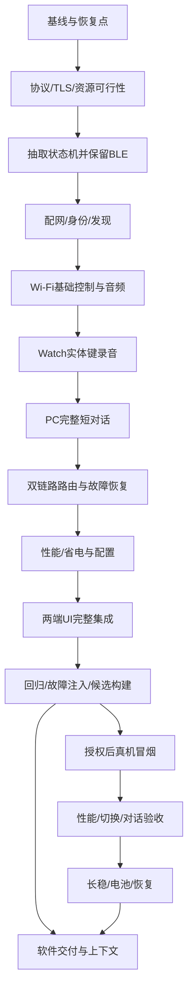

# StopWatch Wi-Fi / BLE 与设备对话：Sol·高目标模式任务书

- 文档版本：v1.0.0；日期：2026-10-04（Asia/Hong_Kong）。
- 实施模型：Sol，`gpt-6-sol`；推理强度：`high`。用户在后续执行聊天选择，不由本规划聊天创建新聊天或自动派发。
- 需求基准：[PRD 34](34-WiFi与BLE自动切换及Watch语音对话PRD-v1.0.0-【codex】.md)。
- 目标源码版本：PC v0.20.0-dev、Watch v0.11.0-dev；若执行时已有新版本占用，按现场基线顺延第二位并记录，不覆盖别人版本。
- 文档状态：可交接执行；产品尚未实施。当前规划聊天没有创建目标、启动开发或授权刷机。

## 1. 任务目标与确定范围

在保留当前 Gork 控制台、角色、自定义表情库、语音模块和 BLE 功能的基础上，让 PC 与 Watch 同连 `vivo200` 热点，通过 Wi-Fi 主通道遥控和传输语音，失效后下一轮回到已认证 BLE；在 Watch 普通小人页按住 A 说话，由 PC 完成识别、AI 回答和短语音回传。

用户已确认全部产品选项，不得重新问一遍：

1. PC 与 Watch 同连手机热点，手机只提供网络，PC 主控。
2. 默认 Wi-Fi 优先，BLE 备用；另有仅蓝牙/仅Wi-Fi，设备本机可恢复。
3. 按住实体键说话、松开发送；单次最多10秒，不做30秒/唤醒词。
4. 中断本轮后由用户重试，下一轮自动选择可用通道；不自动续传或重播。
5. 插电自动性能、电池自动省电；可手动覆盖，在途不因档位改变而中断。
6. 本版不做OTA、无线动效下发、长语音分段、手机APK改造或无PC云对话。

热点密码不在文档中。程序提供私密配置入口；开发者不从聊天日志、历史终端或备份提取密码。

## 2. 目标模式使用与诚实收尾

用户在执行聊天明确“按本任务书目标模式执行”即授权开始本范围的软件实施，不能再停在计划或请求重复开工确认。由 Sol 作为唯一实现者，默认不启用并行实现代理，不创建其他用户聊天。

若当前无活动目标，使用目标工具建立如下完整交付目标；有相同目标则继续，有不同目标则按工具约束处理，不能偷偷替换。未指定 token 预算，不自行设置。

> 完成 PRD 34 与任务书 35 的 PC v0.20.0-dev / Watch v0.11.0-dev 完整交付：保护既有工作，完成 T00–T14，交付实际实现、编译产物、协议、自动与隔离验收及使用/恢复资料。先完成可自主的软件候选和测试准备，再在当次授权范围内实施写入、实际网络与语音测试，完成 A01–A46 和稳定性验收。缺少外部条件时交付真实阶段结果和精确待办，不以模拟结果或软件候选完成冒充整项稳定完成。

默认目标包含完整产品稳定验收；不得在 T11–T13 未验时标记完整目标完成。只有用户在执行聊天明确将目标限定为软件候选交付时，才可采用包含T00–T10、T14软件部分和完整实机测试准备的较小目标，并将T11–T13另列未验。不能为了结束目标自行缩小用户已授权范围。

缺少写入/网络/云调用条件时，继续其余可自主任务，交付候选和精确待办。必要确认在镜像、测试与恢复方案已可审查时提出。目标状态操作遵循宿主工具规则，不因等待一次就标 blocked，不擅自暂停，也不假装硬件门禁已经通过。

## 3. 必读资料与适用规则

按下列顺序读当前文件，历史描述以最新明确范围为准：

1. 根 `AGENTS.md`、`README.md`、`CHANGELOG.md`、`00-docs/00-PRD/02-当前版本计划.md`。
2. PRD 34 和本任务书；[PRD 33](33-v0.19.2-自定义表情库与编辑保存-【codex】.md) 中独立库/默认表情边界。
3. `03-Src/stopwatch-grok-avatar/AGENTS.md`、该目录 README、`docs/HARDWARE_BASELINE.md`、`docs/ENGINEERING_NOTES.md`、`platformio.ini`。
4. PC/固件现有控制、音频、语音会话和UI源码；按任务需要查历史 Opus 与断线记录，不扫描私密配置。
5. [v0.13.0 音频基准](../../04-output/v0.13.0/Opus实施与真机对照-【codex】.md)、当前固件/电脑端恢复说明。

PRD新增Wi-Fi覆盖旧纯BLE范围，不覆盖安全认证和写入边界。不得照搬历史任务书里的“用户已经授权所有实施/重启”当作本次授权。

## 4. 权限、现场门禁与恢复点

| 门禁 | 何时检查 | 通过条件 | 未满足时 |
|---|---|---|---|
| G0 软件执行 | 用户发出执行指示后 | 明确按本任务书实施 | 当前规划只维护文档 |
| G1 工作区保护 | 第一次编辑前 | 根与嵌套Git状态、基线、定点备份、原配置隔离完成 | 先补恢复点，不覆盖 |
| G2 协议与资源可行 | T01结束 | TLS、双链路状态机、10秒内存预算可验证 | 修复/调整技术实现，不降级为开放明文 |
| G3 正式环境使用 | 即将连接设备/切网络/重启正式实例时 | 当前授权覆盖相应影响；隔离进程与正式进程边界清楚 | 用隔离与模拟完成软件；保留明确实测待办 |
| G4 镜像写入 | 每个新镜像写入前 | 当次授权、串口/MAC/型号/当前应用槽/容量、旧镜像恢复路径明确 | 交付镜像和写入计划，不试刷 |
| G5 真实AI/云语音 | 将发生上传或计费请求前 | 当前用户路由与分项许可有效，测试范围已获授权 | 本地ASR/TTS和假服务可测状态机，云实测不填PASS |
| G6 稳定发布结论 | 宣称稳定交付前 | 对应A用例与性能长稳完成，或用户明确接受列出的偏差 | 保持候选与未验清单 |

不需要为例行只读检查、软件测试、构建、隔离UI和范围内可逆修复逐项请示。已经授权的同一操作不重复询问。不得修改手机热点、系统路由/防火墙/代理、设备信任绑定来绕过问题。

恢复点包括要修改的源码和文档、根/嵌套仓库状态清单、构建基线、现有用户参数的保留校验。秘密配置只做用户本机受保护恢复，不复制到版本交付或Git；不把私密音频放入测试数据。

## 5. 文件责任与技术路线

所有生产改动由本执行线程独占。下表为模块划分，不构成并行授权。

| 区域 | 主要已有文件/计划模块 | 边界 |
|---|---|---|
| 固件通信与设备状态 | `03-Src/stopwatch-grok-avatar/src/ble_control.*`、`audio_probe.*`；新增network/transport/task核心 | 保留legacy BLE UUID、加密绑定及诊断协议 |
| 固件UI/按键/音频 | `src/main.cpp`、`sound_control.*`、`speaker_output.*` | 主循环响应；保留驱动/几何资产和Settings组合键 |
| PC设备控制 | `03-Src/stopwatch-voice-companion/companion/robot.py`；新增transport/router/network模块 | 真实适配器，共用取消/任务状态，不复制一个Wi-Fi专用Controller |
| PC语音会话 | `companion/control.py`、`voice.py`、`app.py` | 单活owner/generation、设备委托、许可撤销、哨兵优先级 |
| 音频工具 | `tools/stopwatch_audio.py` 及测试 | 原BLE诊断可用；抽取协议时兼容导入与CLI |
| 控制台/桌面 | `ui/console.html`、`static/`、`03-Src/gork-desktop/` | 复用现有样式和导出链，禁止仅改生成副本 |
| 文档/交付 | PRD 34/任务书35、根上下文、版本输出目录 | 当前、候选、设备三种状态分开 |

具体新模块命名由执行者结合代码确定，避免大面积无关重构。首选PC主动TLS连接Watch、二进制帧与统一任务语义；不开放PC原本机HTTP API。T01先验证成熟TLS实现和协议黄金样本，确认后再开发完整UI。

## 6. 任务依赖与计划



表中阶段按依赖推进；文档、用例和源码验证随开发更新。不得等全部写完才首次编译或运行BLE回归。

### T00 基线、旧行为与定点备份

- 读取真实Git根目录、根与嵌套状态、当前版本；正式服务只读探测时记录未运行/不可达，不自动启动。
- 枚举后再读取文件；执行时确认Windows、工具路径、项目venv、Node/PIO版本；不写死某台机器的Codex/rg路径。
- 建立 `Codex-Temp/wifi-ble-v020/baseline/`：本轮可能覆盖文件的副本、路径清单、dirty摘要、测试命令与结果；私密配置隔离。
- 跑现有相关最小基线：PC控制/音频、BLE工具、控制台、桌面及固件构建。已有失败逐项归因，不把历史失败归本版也不掩盖。
- 输出：`开发基线与差异-【codex】.md`。退出：G1通过、旧行为可比较。映射A01/A02/A42。

### T01 固定协议、状态与资源设计

- 在锁定工具链验证TLS服务与PC客户端的握手/身份校验可编译；无写入授权时只能标编译/宿主握手测试，不称设备性能通过。
- 冻结帧头/字节序/类型/长度/CRC、认证、能力字段、任务标识、去重、状态查询、超时、错误码和版本协商；给出PC与C++共用黄金样本。
- 定义传输接口与固件任务核心；音频一次仅有一个owner，明确CANCEL绕过数据队列优先执行。
- 核算320,000字节录音、480,000字节上限、Opus解码、TLS和绘制的峰值；定义运行时测量钩子。
- 输出：`协议与架构决策-【codex】.md`、黄金样本、资源预算；新模块最小可编译。退出：G2的软件部分有证据。映射A08/A14–A16/A36。

### T02 抽取核心，确保旧BLE不退化

- 从AudioProbe中分离音频生命周期、任务与缓冲管理，BLE回调转为适配层；保留旧诊断入口、服务UUID、CAPS兼容。
- PC去除“整个音频任务必须拿到Bleak对象”的业务假设；旧BLE适配仍可独立运行。
- 复用原ES8311/功放/音量逻辑，保留取消、租约、数据校验和COMMIT→文字→PLAY。
- 测试重复/乱序/断线/取消的真实生产状态机，至少C++宿主测试与Python契约测试共用样本；不只测试临时替身逻辑。
- 退出：BLE相关回归和固件构建通过，旧工具调用未破坏。映射A14/A24/A27/A32/A36/A42。

### T03 热点配置、认证和自动发现

- 加密可信BLE首次配置SSID、密码与独立PC认证身份；输入掩码、响应不回显，设备确认写入才显示成功。
- Watch自动连接已保存热点；异步连接、错误分类、有限退避；加入网络专用设置和仅蓝牙恢复入口。
- 实现已认证BLE端点发现、mDNS、合法缓存及手动IP；固定设备身份验证，拒绝伪装设备/无关地址。
- 确保PC原8766/8765依然loopback，无全网扫描，无修改系统路由/防火墙。
- 自动测试TLS认证失败、配置损坏/断电、IP变更、热点不可见与错误密码，提供真机诊断工具。
- 退出：生产配置链路和真实TLS客户端/服务器可运行；无设备时保留配网实测NOT_RUN。映射A02–A08/A12/A35/A43。

### T04 Wi-Fi基础遥控与完整音频段

- 经统一核心实现表情、短文字、清除、短音以及已有支持控制；遵守字符/UTF-8限制和单任务执行。
- 二进制音频数据采用有界批量帧与适当背压，不复制BLE每小包等ACK节奏；控制和停止不被大数据饥饿。
- 下行PC Opus/PCM→COMMIT→对应文字→PLAY，上行Watch PCM→PC完整WAV；最大长度/格式双端校验。
- 回执分“接收、应用、播放开始、播放结束”，失败原因可定位；不把transport.write成功当执行成功。
- 退出：真实实现与有界协议测试通过，固件构建通过，宿主集成收发音频完全一致。映射A14/A31/A32/A36/A37。

### T05 普通小人页按键说话

- 实现A短按原表情、A长按录音、松开提交、B停止、A+B优先设置；长按/取消后消费click。
- 录音前检查已认证设备语音会话就绪，准备完成再显示“开始说话”；显示10秒倒计时并自动结束。
- 仅用已有驱动做16kHz/16bit/mono PCM；停止扬声器后才能启动麦克风；每条失败路径完整释放。
- 录音中的双键、设置切换、会话撤销、断线、过短/空音频均不得上传旧片段。
- 退出：输入时序和硬件资源所有权测试通过；录音诊断入口保留；实体手感列T11验证。映射A20–A24/A30/A44。

### T06 PC识别、AI、TTS与Watch闭环

- 增加设备语音会话委托，复用现有Controller/voice client和取消代际；不伪造UI owner，不另起语音引擎。
- 新的设备按键入口经过现有许可检查，启用开关默认关闭；用户已有偏好不重置。
- 跑通录音上传→本地ASR→既有回答适配→TTS→音频长度校验→Watch播放；PC显示阶段、识别文本、完整回答和耗时。
- 默认短回答；音频超10秒时文本保留、声音明确未播，不截断、不自动分段；显式缩短按钮才产生新请求。
- 取消PC/Watch旧任务及迟到结果；与自动哨兵共用调度，手动语音优先。
- 用确定性音频与可控服务测试生产管线，再做可用本地ASR/TTS实测；真正云AI/TTS依G5，不能用mock代替。
- 退出：所有阶段可取消且无串轮，许可/owner测试通过，短对话生产链路完整。映射A19/A22/A25–A33。

### T07 自动Wi-Fi优先与下一轮回退

- 实现三种策略；区分链路健康、能力就绪、手动断开、当前任务固定链路。
- 单独注入备用链路掉线：Wi-Fi任务不能被BLE linkEpoch变化停止，BLE任务不能被后台Wi-Fi扫描失败取消；只有当前任务所依赖的链路失败才结束本轮。
- 实现共享任务身份/状态表、幂等PLAY、终态查询、旧会话拒绝；断线结束本轮，禁止另一链路自动重放。
- 实现健康观察、冷却、退避；Wi-Fi恢复只影响下次任务。记录选择原因，UI不只显示信号强度。
- 保留已认证BLE的轻量备用策略；如采用断开备用，单独验收冷回退且记录原因。
- 故障注入覆盖每一个语音阶段和“PLAY已经执行但ACK丢失”；跨链路CANCEL只结束同一任务。
- 退出：双真实适配实现的自动集成测试通过，无重复朗读/旧任务复活。映射A09–A19/A30/A38。

### T08 性能/省电和持久化

- 使用真实USB/外部电源状态；满电插USB不能误判电池。硬件接口无法可靠区分时显示未知并按eco，不猜测。
- 独立保存连接策略与电源选择；auto切实际档，手动override跨重启保留。
- 在空闲处改变扫描/重试/省电参数，活跃录音/播放保持响应；本版不进入使网络长期离线的deep sleep。
- 记录实际生效配置、来源、供电与重连次数，脱敏且有界；防止每轮写flash。
- 退出：模拟电源序列、热插拔过渡、配置迁移/断电测试通过。映射A34/A35/A39/A40。

### T09 控制台、设备界面与真实隔离UI

- StopWatch页加入连接、配网、策略、电源区域；对话页加入Watch输入/启用/阶段/停止/超长未播放提示。
- 保留Mantine/经典主题、现有布局和菜单；网络状态不重建头像播放器、不覆盖编辑草稿。
- Watch设置提供网络状态、切换/忘记/重连和仅BLE；普通页提示不遮挡眼睛/气泡，设备失联仍可操作。
- 通过源模板和已有构建/导出工具更新生成副本；如变更了共享头像源，再运行原导出，禁止直接改副本。
- 隔离Electron和网页实测：常规/窄窗、缩放、热切模式、错误状态、密码不回显、保存回执、版本显示。
- 退出：真实隔离窗口证据与UI回归通过；无法打开时记限制，不用DOM测试冒充实窗。映射A03/A09/A31/A35/A41–A43。

### T10 全面回归、故障注入和候选包

- 完成全部适用Python、Node、C++协议/状态机/音频/角色回归及固件构建；先修新回归，再分析既有失败。
- 注入半包、超长帧、错CRC、坏Opus、乱序/重复、慢消费者、断线、旧任务、队列溢出、认证失败、内存分配失败与取消竞争。
- 验证关闭后无悬挂异步任务/进程、旧代际无音频、生成文件一致、现有参数原值未变。
- 打包版本化app候选，记录实际应用容量、工具链和构建命令；不修改/写入分区，不提供盲目硬编码COM的刷机脚本。
- 准备T11–T13逐步操作、半自动日志工具、回退文档和A矩阵，所有设备用例初始NOT_RUN。
- 退出：软件候选可审查且测试真实通过；阻塞项列清。映射A01/A08/A14–A19/A27–A32/A35/A36/A42/A43/A46。

### T11 当次授权后的设备冒烟

- 先核对当前串口、MAC、型号、实际应用槽/容量、已有恢复应用；不得复用历史COM5当现场事实。
- 列出设备v0.9.1-dev到完整新候选的差异，包括当前源码v0.10.0-dev中尚未实机验收的动效；把其屏幕/帧率/默认动作等原门槛纳入冒烟，不把旧候选夹带成“只有Wi-Fi改动”。
- 写入仅覆盖经核对的目标应用区；使用工具写入校验并独立必要读回。没有授权不执行写入，不清NVS/绑定、不刷整片。
- 检查版本实屏、旧BLE遥控、音量/亮度/默认动作；完成热点配网、PC认证、PC基本命令回执。
- 验证按键仲裁、录音/停止、10秒边界、真实声音清晰与同步；失败先恢复可操作BLE，再定位。
- 退出：冒烟门槛逐项通过，或记录真实失败和安全恢复状态；不得直接进入长稳掩盖基本故障。
- 映射A03–A10/A20–A24/A27/A32–A35/A43/A44/A46。

### T12 性能、对话与100次恢复

- 依PRD第10节环境记录做当次BLE/Wi-Fi对照，不直接使用历史3.66秒作为本次BLE值。
- 执行控制1000条、下行/上行各至少30次、Wi-Fi100轮与BLE20轮短对话；区分真实语音服务与协议测试数据。
- 100次故障恢复分组覆盖热点关闭/锁屏、PC退出、设备重启、IP变化、仅业务服务故障、弱信号；记录每组次数，避免100次都测同一种断线。
- AI/TTS实测使用已允许路径与有限测试集合，不反复生成云语音作纯网络压测；可用固定已生成音频做传输测试但不冒充新AI对话。
- 保存样本数、P50/P95/max、失败数、恢复原因、终态；检测重复播放和旧录音恢复上送。
- 退出：相关门槛通过，否则修复后重跑受影响部分；不为通过而降低用例次数或删除失败。
- 映射A05–A19/A25/A26/A30–A33/A37/A38/A44。

### T13 长稳、电池、恢复与人工验收

- 插电8小时活动循环，记录内存/最大连续块/PSRAM、帧时、连接、错误和停止能力；完成至少500次资源循环。
- 长测脚本支持停止、日志落盘和断点统计；使用隐藏后台进程并记录PID/命令/测试条件。断点恢复不能把多段碎片凑成“连续8小时”。
- 不使用长时间阻塞工具调用妨碍用户操作，不擅建定时自动化。用户中止时保存实测时长并诚实列未完成。
- 电池eco与仅BLE在固定亮度/负载下对照，记录实际时间、估算电量和关机条件；电量百分比不冒充精确mAh。
- 测旧应用恢复仅在当次授权覆盖时执行；未实测就交付具体恢复步骤并标NOT_RUN，不能宣称已验证回退。
- 由用户完成必要实屏/听感确认，记录原话与对应版本，不靠PLAYED推断可闻。
- 退出：A39/A40/A45及人工项通过或明确未验，软件候选和稳定验收状态分别结算。

### T14 交付、版本、项目上下文与本地归档

- PC版本至少检查 `companion/__init__.py`、两处package.json及锁文件；固件版本检查main.cpp和交付名，设备版本仅按真实更新记录。
- 同步根README、当前计划、CHANGELOG及必要项目AGENTS；保留最近5个软件版本，其余转历史归档。不要把规划文档v1.0.0当成软件已发布。
- 给A01–A46每项结果、证据链接、失败/未测原因；汇总NOT_RUN/BLOCKED/FAIL数量，区分软件完成与产品稳定完成。
- 输出实际文件变更清单和使用/恢复文档；写入授权缺失时交付镜像、目标应用区域核对方法和恢复资料，确认请求最后才提出。
- 按项目第二位版本变化默认进行本地Git存档，不自动推送；若执行会话明确禁止Git存档，以该指示为准。混合dirty不能用`git add -A`，可采用精确白名单的临时index/独立快照ref，保留原分支/index/工作树；注明包含哪些既有依赖，不伪称均为本轮修改。
- 检查嵌套仓库边界，不打包.git、venv、node_modules、秘密配置、NVS、整片备份、私人音频或快捷方式；固件目录规则禁止提交二进制时，产物留在本地交付目录，不塞入嵌套Git。
- 不创建PR、不公开发布、不推送、不向其他聊天或外部平台发消息，除非用户另有明确授权。

## 7. 验证方法和命令

先探测可用运行时，再运行以下现有入口。示例相对项目根，不把路径当成机器全局已安装保证。若入口发生变化，读当前脚本后使用真实命令并记录。

```powershell
git status --short
git -C 03-Src/stopwatch-grok-avatar status --short
& 'Codex-Temp/.venv-companion/Scripts/python.exe' -m pytest '03-Src/stopwatch-voice-companion/tests' -q
npm --prefix '03-Src/stopwatch-voice-companion' run build:ui
npm --prefix '03-Src/stopwatch-voice-companion' run check:ui
npm --prefix '03-Src/stopwatch-voice-companion' test
npm --prefix '03-Src/stopwatch-voice-companion' run test:motion
npm --prefix '03-Src/gork-desktop' test
pio run -d '03-Src/stopwatch-grok-avatar' -e m5stack-stopwatch
git diff --check
```

另按文件入口运行 `tools/test_stopwatch_audio.py`、`tools/test_ble_expression_console.py`、`tools/test_stopwatch_sound.py` 和必要的动效原生专项；新增协议/路由/C++核心测试必须加入可重复入口，不能只留一次性终端片段。

隔离环境必须关闭自动连真机、语音服务托管、自动云请求和两类哨兵，使用独立端口及独立配置。只终止自身PID；不误杀正式Electron、8766/8765、Codex或系统代理。不改变已有motion-library或连接偏好做测试。

计时测试采用单调时钟；假时钟验证状态机时序，真实时钟验证性能，分开记。音频监听/物理按键/实屏必须使用设备证据，浏览器与宿主替身不算设备PASS。

## 8. 需求到任务与验收的追踪

| PRD范围 | 实施任务 | 关键验收 |
|---|---|---|
| 第4节拓扑/配置/身份 | T01/T03/T04 | A03–A08/A43 |
| 第5节选择/去重/取消 | T01/T02/T07 | A09–A19/A30/A38 |
| 第6节PTT/短对话 | T05/T06 | A20–A33/A44 |
| 第7节协议/API | T01–T04/T06 | A08/A14–A16/A27–A29/A36 |
| 第8节界面/配置/恢复 | T03/T08/T09/T13 | A02/A12/A34/A35/A41–A43/A45 |
| 第9节资源与实时性 | T01/T02/T04/T08/T13 | A24/A36/A39/A40/A44 |
| 第10节定量稳定性 | T11/T12/T13 | A25/A26/A33/A37–A40/A44 |
| 第14节交付 | T00/T10/T14 | A01/A42/A43/A46 |

完整矩阵以PRD的A01–A46为唯一列表，执行报告逐项扩展证据，不另造缩水验收清单。当前本规划交付不执行这些产品测试，所有产品验收初始均NOT_RUN。

## 9. 输出目录与报告格式

实施后新建，不在规划阶段伪造产物：

```text
04-output/v0.20.0/
  开发基线与差异-【codex】.md
  协议与架构决策-【codex】.md
  WiFi与BLE及Watch语音实施验收-【codex】.md
  热点配网与语音使用说明-【codex】.md
  升级与BLE恢复操作-【codex】.md
  tests/                       # 脱敏结果/统计/必要界面证据
04-output/v0.11.0/firmware/
  StopWatch-Gork-v0.11.0-dev-app.bin
Codex-Temp/wifi-ble-v020/
  baseline/                    # 本轮覆盖前恢复点
  logs/                        # 有界脱敏日志
  private/                     # 仅确有必要且受保护的本地数据，不提交
```

实际版本顺延则目录同步。常规迭代不强制新建SHA256SUMS；设备写入工具的校验与必要读回不可省略。

实施验收报告至少含：

1. 用户已确认需求、实际源码/实例/设备版本和授权范围。
2. T00–T14状态、实际改动、测试命令与结果、ADR偏差。
3. A01–A46逐项状态、证据路径、样本数、失败原因、未验条件。
4. 性能P50/P95/max、100次恢复构成、长稳连续时长、内存/帧率和电池对照。
5. 真实声音/显示与旧版回退结论，禁止写成设备返回值即完成听验。
6. 所有未通过项的数量、影响、下一操作和是否需要用户动作；不能只写“少量待验”。
7. 文件清单、用户数据保留情况、备份路径、本地Git归档状态及恢复步骤。

## 10. 执行时不得采取的捷径

- 不因Wi-Fi连接成功就把业务认证和PC控制标PASS。
- 不把同热点当作可信身份，不用开放写入解决配对问题。
- 不改变PC系统联网策略或开公网代理来掩盖热点隔离。
- 不让两个传输适配器分别拥有独立“当前语音任务”。
- 不用固定delay或不断重启来代替状态机、幂等、退避和资源回收。
- 不把默认10秒限制改成30秒，不剪掉回答末尾，不自动分段重试。
- 不清绑定/重置配置来使测试通过，不覆盖当前自定义表情库。
- 不把接口返回PLAYED、自动截图或成功编译写成用户听验/真机稳定。
- 不因硬件门禁缺失停下全部软件工作，也不在外部条件未满足时反复尝试有副作用的操作。

## 11. 可直接粘贴给Sol·高的启动提示词

> 请使用 Sol（gpt-6-sol），推理强度 high，按目标模式执行本项目 `00-docs/00-PRD/34-WiFi与BLE自动切换及Watch语音对话PRD-v1.0.0-【codex】.md` 和 `35-WiFi与BLE及Watch语音Sol高目标模式任务书-v1.0.0-【codex】.md`。先读取根与固件AGENTS、README、CHANGELOG和当前版本计划，保护根及嵌套仓库已有dirty工作并建立定点备份。用户已确定PC与Watch同连vivo200热点、Wi-Fi优先/BLE后备、按住A说话且单次最多10秒、断线结束本轮由用户重试、插电自动性能/电池自动省电并可手动覆盖，不要重新询问这些选择。请建立或继续任务书第2节的完整交付目标，实施T00–T14；先持续完成所有可自主源码、固件构建、协议/故障注入、隔离UI验证和实机测试准备，再在当次授权范围内完成T11–T13及稳定验收。必须复用现有语音会话/许可/取消逻辑，保留旧BLE和角色配置，禁止用mock代替真实实现或声称设备稳定。新镜像写入、正式网络/实例操作及真实云调用按任务书实际授权边界处理；先准备好可审查结果，再提出缺失的必要确认。不开其他实现代理，不创建新聊天，不自动推送或公开发布，不泄露/硬编码热点凭据。完整记录A01–A46、未验数量、实际版本与恢复方法；软件候选完成与真机稳定验收分别报告，真机门槛未满足不得自行缩小目标或把完整目标标为完成。

如执行条件暂不具备，阶段性交付可用软件候选和明确的剩余任务；调整目标范围必须来自用户明确指示，不得只改结论文字而省略测试。

## 2026-10-04 用户追加：短按录音与命名表情

本补充覆盖本文件“按住说话/松开发送”的产品手势：黄色G2/A短按开始，亮REC后说话，再按结束并发送；准备期间第二次短按取消，蓝G1/B取消，A+B设置，最长10秒。Audio test诊断继续按住/松开，上传许可/单链路/代际/断线终止不变。Watch默认启动恢复原版idle，库r14三个命名表情独立编入候选，无运行时JSON同步。用户当次授权后v0.11.6仅app0写入并独立校验；真实手势、三个表情/待机实屏和听感仍待验，不能把宿主测试计入T12/T13。

## 2026-10-04 用户调整（当前优先于原现场待验要求）

用户针对“最新固件v0.11.7写入校验已通过，录音提示、双端书写和实际听感仍缺完整确认”回复“已经完成”（原消息“一斤完成”）。这三项更新为用户实机确认完成，不再重复列为缺失确认；未提供新的分段延迟、帧率或量化对照数据，不推导为性能验收通过。

用户明确“真机性能与稳定性先不测了”：T12/T13的性能对照、批量对话/故障恢复、8小时长稳、资源循环、电池对照及回退验证延期，不执行、不标PASS，也不再当作本轮必须继续跑的工作。原完整验收标准保留用于以后恢复。

已核对v0.11.7源码，Settings → Network已有三档策略：Auto WiFi first / BLE only / WiFi only。点第一行轮换到BLE only会保存策略、关闭Wi-Fi并停止相关网络入口，热点和蓝牙绑定不清除；选择Auto WiFi first恢复热点尝试。若Bluetooth的Control为OFF，用户须先点BLE ON。首次应用保存约延迟300ms且避开音频忙，重启后恢复策略。菜单功能已存在，本轮不改代码、不构建或再烧录。

“选择蓝牙模式”与“Windows完整服务发现/旧通信已恢复”分开记录：菜单路径有源码依据，旧电脑蓝牙发现异常未因本次记录自动关闭，基础通信仍需实际选择后核对。完整边合成/边传/边播尚未实现，保留PRD36后续路线；不因用户实机确认推导为流式完成。PC当前源码版本保持v0.20.17-dev，正式运行版本另行读取。本轮仅更新记录，不改网络、服务、绑定或设备。

见04-output/v0.11.7/用户确认与连接模式说明-【codex】.md。
