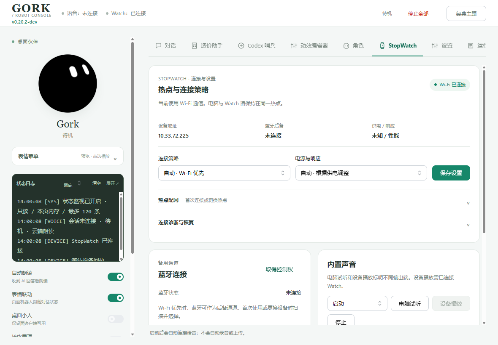
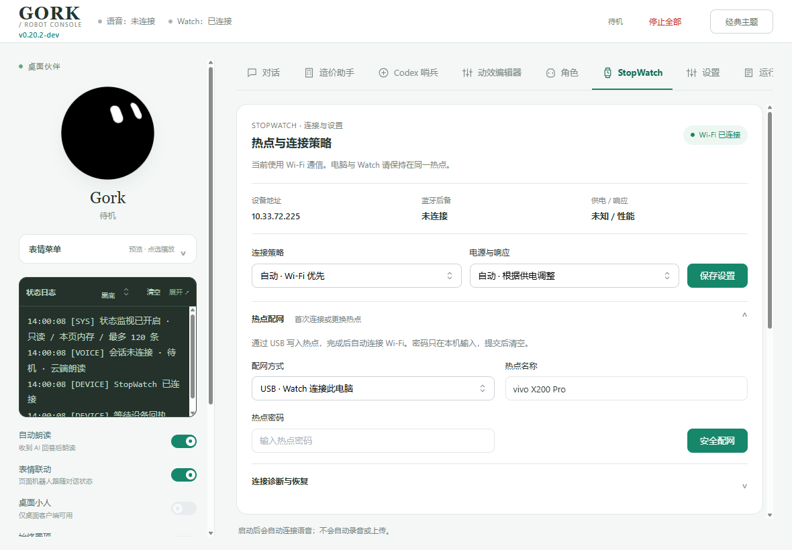
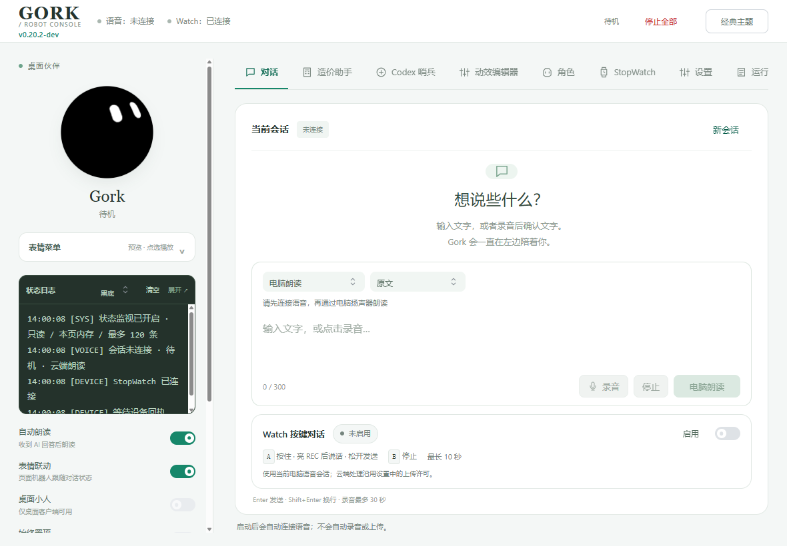

# PC v0.20.2-dev StopWatch连接与按键对话界面修复

用户反馈日期：2026-10-04。两张截图显示网络模块裸输入框、标签/按钮挤压、双卡状态矛盾；对话区Watch模块过大，未启用仍展示空操作与结果。

## 修改

网络面板跨两列，当前链路状态与IP/蓝牙后备/供电分栏；连接策略/响应设置统一栅格并右对齐保存。配网与诊断原生details可展开，输入框经过TextInput正式构建；两主题使用相同字段结构，390px逐行排列。供电未知明确为未知，避免原始unknown/authenticated PC占据用户界面。

Watch按键对话采用正式Switch，头部简短状态与按键提示；启用时出现停止，超长未播放时出现缩短回答。有识别/回答才出现折叠结果，文字仍通过textContent绘制。经典主题窄屏收紧伙伴区以保持编辑器和Watch开关可见。

蓝牙卡片只读真实network.ble_connected，Wi-Fi连接不再被画成蓝牙连接。历史设备操作错误仅提示查看诊断，不覆盖实时网络状态。原有命令、配网、权限、提交清空密码、主题切换保留DOM/草稿语义不变。

## 验证与限制

- npm run build:ui / check:ui：源码与生成页一致，无内联样式放宽。
- 前端62项回归：包含秘密输入提交清空、两链路状态、表单展开/焦点草稿保留、关闭/启用/超长状态操作、结果纯文本，以及既有59项兼容。
- Electron桌面既有32项回归通过；控制台与桌面package/lock及Python版本均为v0.20.2-dev。
- tools/verify_stopwatch_ui.cjs：隔离profile/本地HTTP假数据/隐藏离屏Electron渲染，无真实设备或云连接。两主题、四宽度1480/1180/800/390、配网收起/展开与对话区共24种布局，控件不重叠/不横向裁切，输入与Watch开关在视窗内。tests/layout.json和截图为证据。
- 修复截图采集时隐藏原生窗口的旧合成帧问题，使用离屏渲染且检查可见目标及控件数量，实际查看两主题/窄屏图；这些是隔离渲染，不冒充正式程序验收。
- PC源码与UI/Electron元数据v0.20.2-dev；正式8766当前未运行，需要正常打开程序。Watch保持已验v0.11.5-dev，未烧录；Wi-Fi业务/PTT听感/长稳仍按原门禁待验。

README、项目AGENTS、当前计划和CHANGELOG已更新，最近5版本之外转历史归档；未提交/推送。

## 截图

