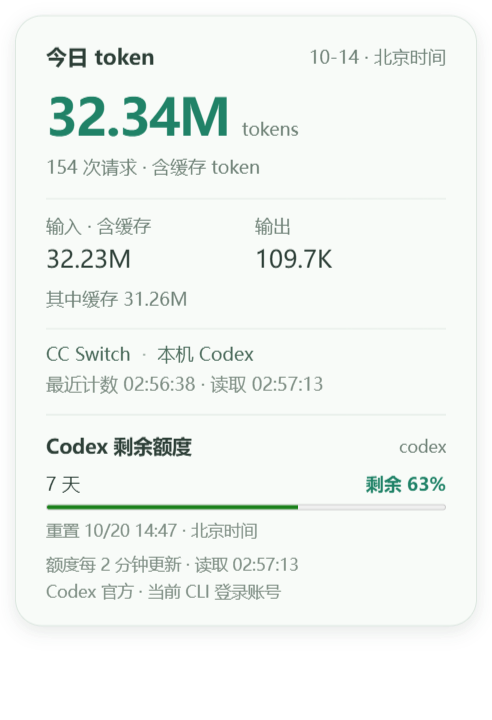

# 今日 token 与额度悬停卡片验收

版本：PC v0.20.34-dev。日期：2026-10-14。

鼠标移到桌面悬浮小人时，原今日 token 卡片同时显示 Codex 剩余额度百分比、进度条、额度窗口及北京时间重置时间；移开收起，键盘聚焦/Esc 保留。CC Switch 本机 Codex 今日 token 与 Codex 官方当前 CLI 登录账号额度分开注明来源。只显示实际返回窗口，不补造不存在的 5 小时窗口；沿用哨兵当前 bucket 选择，无匹配时采用接口返回的首个 bucket。旧圆环、哨兵设置、鼠标跟随、拖动与声音流程保持。

## 读取与失败处理

- 今日 token 延续 v0.20.33 的 CC Switch 只读计数和 20 秒缓存，计数公式、北京时间日期及数据库不变。
- `GET /api/desktop/quota-usage` 复用现有 `QuotaRPC` 与 `quota_snapshot`。只执行 initialize、account/read（refreshToken=false）、account/rateLimits/read；不启动任务、审批、额度重置、登录或声音。
- 哨兵已启用且额度新鲜时复用其快照；哨兵关闭或数据过期时以独立短生命周期 app-server 查询，不改变任务哨兵偏好。只在悬停时发起客户端查询，每20秒取缓存；后端120秒缓存、并发合并，异常/已过期服务端窗口30秒退避，进程读取超时12秒并清理。
- 今日 token 与额度独立更新，慢额度不阻塞 token；移开、隐藏、最小化、退出停止新轮询，晚到结果不重新打开窗口。
- `remaining_percent=100-usedPercent` 沿用现有归一逻辑，实际0%保留，缺值显示未知。读失败保留旧快照且标记「上次额度」；跨越重置或读取时间超过5分钟标记过期，不自动假定恢复100%。明确未登录、API Key或不支持账号时清除旧百分比。响应不回显异常文本、路径、凭据或账号身份。

## 验证结果

| 检查 | 结果 |
| --- | --- |
| Python 定点回归 | 61项通过：新增额度缓存/并发、关闭哨兵独立读取、复用哨兵、过期、退避、账号变化清旧值及真实路由测试；CC Switch、Codex哨兵和后端相关回归通过 |
| 桌面回归 | 48项通过；最终渲染变化后5项卡片定点回归再次通过，包含慢额度与晚到隐藏响应 |
| 实际官方只读读取 | 适配器返回 available，本次快照仅一个7天窗口、剩余63%，重置2026-10-20 14:47（北京时间）；这是当次快照，不是固定值 |
| 隔离 Electron 实窗 | 生产 v0.20.34 main/preload/avatar/card，真实Chromium鼠标输入；读取真实安全聚合快照显示，单窗口/两窗口、0%、25/100/150%小人、150%DPI、420DIP短屏布局、不抢焦点、旧值/API Key/缺库、隐藏恢复/Esc/聚焦均通过；没有语音/设备写请求 |
| 生成一致性 | `npm run check:ui`、`python tools/export_desktop_avatar.py --check`通过 |
| 正式程序 | 只读复核仍v0.20.33-dev，Codex哨兵仍disabled；未强制退出、接管或重启，新main和后端需要从托盘正常退出、原启动入口重开后加载 |

隔离窗口的双窗口测试使用明确的测试值，截图「hover-live」采用当前真实官方额度和CC Switch计数快照。此实窗验证不是正式现用进程已升级的证据。

可重复执行脚本：`tools/verify_quota_hover_electron.cjs`。独立 profile/HTTP fixture 与安全聚合数据位于 `Codex-Temp/quota-hover-20261014/`，不复制 CC Switch 数据库或凭据。初次测试的窗口初始化等待错误已在测试脚本修复，保留 `before-test-wait-fix.log`，最终结果为 `electron-result.json` 中 PASS。

元数据、README、项目AGENTS、当前版本计划和CHANGELOG已更新；CHANGELOG保留最近5版，其余转历史归档。未改Watch固件、网络、许可或现用语音owner，未烧录、未提交推送；性能/长稳延期保持。

