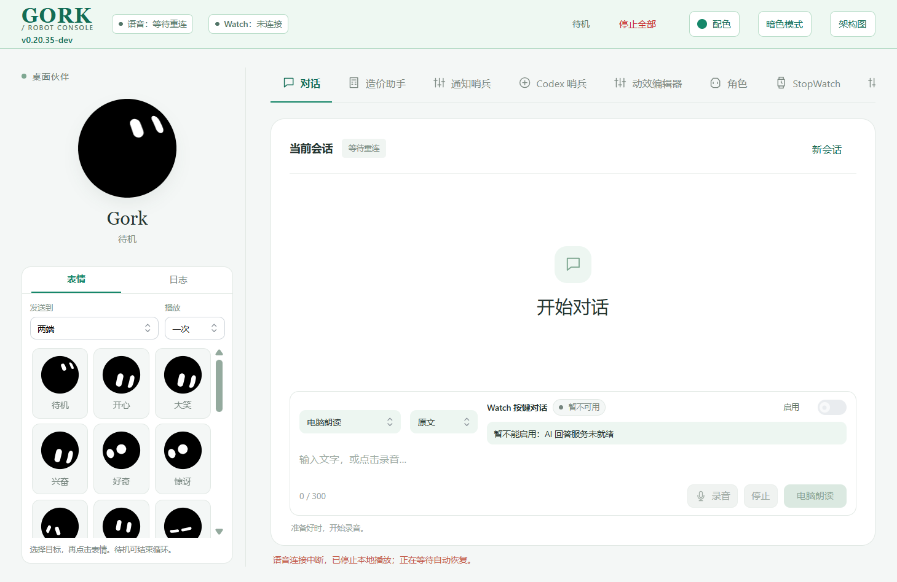

# 语音自动连接与断线恢复验收

PC v0.20.35-dev，2026-10-14。

## 原因及现场

用户截图及当次只读检查确认正式版本v0.20.34-dev，`auto_connect_voice=true`，托管语音服务ready，工作台仍有控制权，但`session_active=false`。原网页`startupVoice.done`在首次连接成功后永久置true；后续心跳失败只停止本地播放并设未连接，不再自动恢复。启动失败60次后也永久停止。后端临时503/超时与真正401会话失效共用清归属处理，仍有效的服务端会话可能被留成占用状态。

这解释了“服务在线、语音未连接”的状态；不把服务ready当成语音会话已经连接。

## 修改行为

- 默认自动连接沿用原`auto_connect_voice=true`。首次成功后仍允许恢复，暂时失败按1/2/4/8/16/30秒退避持续等待，超过原60次也不永久停止。
- 心跳断线停止本地播放/录音和旧交互，等待自动连接；顶栏及会话区域显示「连接中」或「等待重连」。恢复不重新播放旧答案、不启动麦克风、不调用识别/合成。
- 后端临时503/超时保留原语音归属。相同owner重连先验证原会话，有效则复用，返回真实generation，保留音色、上传许可和后台历史；失效才创建新会话。网页沿返回generation应用界面当前音色/路径及独立许可，设置暂时失败也退避恢复，不报告已应用。
- 前后端都对迟到响应做保护，旧心跳不能清除新会话，旧连接响应不能撤销主动断开。
- 自动连接只使用`replace=false`；其他窗口/程序占用时暂停并保留明确接管入口，不自动接管。主动释放语音、离开页面及协议/需调整设置错误暂停自动尝试；手动连接重新启用。后端配置关闭自动连接时保持关闭。
- 仅在健康信息明确报告已配置的管理器处于offline时请求原本机启动入口；仍运行、正在启动和外部管理的服务不自动重启。后台现有启动任务合并逻辑保留。

## 验证

| 检查 | 结果 |
| --- | --- |
| 先复现后修复 | 新断线恢复、超过原60次、后端临时心跳三处回归在原代码下失败，修复后通过 |
| 网页回归 | 106项通过，包括新增真实app.js处理器测试：首次成功后掉线、代际/设置失败、持续退避、主动断开、占用、迟到心跳/连接、托管服务恢复以及原音色/许可/语音交互 |
| Python回归 | 50项通过（test_companion、test_auto_connect、test_voice_options），覆盖原会话恢复、权限/接管/取消、设备自动连接与音色保持 |
| 生成检查 | `npm run check:ui`通过；本轮仅改static/app.js和Controller，不直接改生成控制台HTML或共享角色renderer |
| 隔离真实Electron | 加载正式生成HTML、生产ES模块和真实周期心跳，独立HTTP fixture/profile。启动自动连接、会话掉线后自动恢复、已选Ethan及撤销的音频/回答上传许可保持、主动断开5.5秒不重连、其他owner占用暂停；没有ASR/TTS/回答或设备播放请求。最终PASS见electron-result.json |
| 正式现用程序 | 结束时再次只读确认仍v0.20.34-dev，voice_ready=true、session_active=false。没有强杀、接管、刷新或重启；新前端和后端须正常托盘退出、原入口重开加载 |

隔离Electron服务响应是故障注入替身，验证真实页面及定时器行为；不当作正式进程已加载v0.20.35或用户耳听/Watch业务验收。验证没有真实云端请求。

可复用实窗脚本：`tools/verify_voice_reconnect_electron.cjs`。源码定点备份与过程文件保留在`Codex-Temp/voice-reconnect-20261014/`。安全正式摘要见formal-runtime.json，未保存owner/session凭据。

元数据、README、AGENTS项目经验、当前版本计划和CHANGELOG更新为v0.20.35-dev，CHANGELOG仅保留最近5版。现用音色、云端许可、网络及Watch固件保持；未烧录、未提交推送，原真机性能/长稳延期保持。

