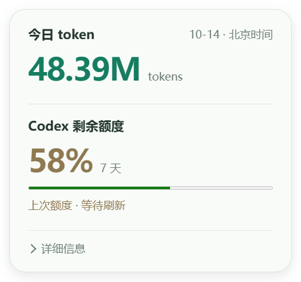
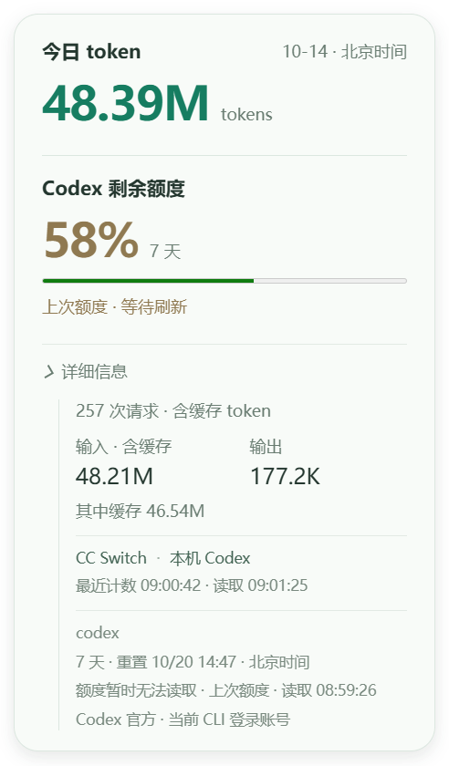

# token与额度大字及折叠详情验收

PC v0.20.36-dev，2026-10-14。

默认卡片只显示今日token总量、Codex剩余额度大数字、实际窗口名称、进度条及「详细信息」入口。剩余额度移到左侧，与token总量同为34px、相同字重及左边缘。请求次数、输入/输出、缓存、来源、计数/读取时间、bucket及重置时间收入默认关闭的details下拉，展开后向内缩进。

错误或旧值标记仍在大数字下方显示，未知为「—」，真实0%保持0%；不因为折叠详情而隐去数据时效问题。统计来源和百分比计算没有修改。

卡片接受点击，使用小人和卡片各自的悬停来源保持窗口，跨入卡片不收起，离开两者150ms后收起；完整离开后再次查看默认折叠。原不主动抢焦点、位置/置顶、隐藏/退出取消轮询、Esc保持。内容高度经受限IPC调整，超过所在显示器工作区时以工作区高度显示并允许滚动；只接受本卡片webContents的180–900DIP高度，小人/本卡片可悬停与收起，控制台及其他窗口不能调用。

## 验证

- 桌面完整48项回归通过，覆盖发送窗口限制、悬停生命周期、双来源保持、内容高度、原头像/鼠标跟随/表情/气泡/启动与退出。
- `npm run check:ui`通过；没有修改共享renderer、后端统计或语音逻辑。
- 隔离Electron使用生产main/preload/avatar/card和真实Chromium鼠标输入，通过点击summary展开、鼠标从小人跨到卡片保持、再离开后自动折叠、Esc/隐藏恢复、25/100/150%小人尺寸及短屏布局。
- 实际计算样式确认token字号=34px、额度字号=34px，左边缘均30.6667DIP；details初始closed且内容不可见，展开后窗口自动增高。
- 当前正式v0.20.35只读接口的安全聚合快照用作实窗输入。本次token为48,390,142；额度接口返回上次58%并标记unavailable/stale，卡片正确显示「上次额度 · 等待刷新」。这是当次快照，不是固定示例或当前额度持续不变的承诺。
- 双窗口测试使用明确测试值0%/76.6%；缺库、API Key及旧值检查保留。无声音/设备写请求，未接管现用owner。

结果见electron-result.json；可重复实窗脚本为tools/verify_token_layout_electron.cjs，独立profile、定点备份与过程保留在Codex-Temp/token-layout-20261014。

元数据、README、项目AGENTS、当前版本计划及CHANGELOG已更新，CHANGELOG保留5版。正式现用进程仍v0.20.35；新main/preload须从托盘正常退出、原入口重开加载。Watch固件、声音、网络和上传许可保持，未烧录、未提交推送。

