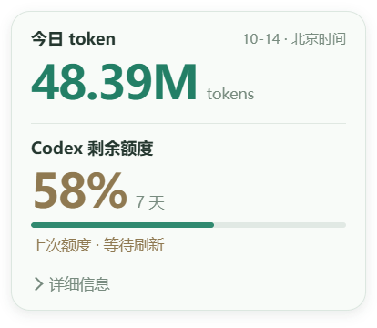
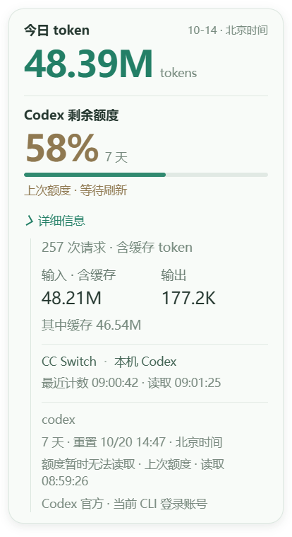

# 悬停卡片紧凑精修验收

PC v0.20.37-dev，2026-10-14。

按照用户反馈缩小悬停卡片。宽度328→276DIP，外边距10→8DIP，内边距18/20/15→12/14/10DIP，圆角18→14DIP，减轻阴影。标题12px、日期10px、单位11px，收紧数字与标题/上下区块间距，去掉详情入口前的分隔线，额度条改为4DIP细圆角线。

token及额度百分比继续共用34px字重/字号且左对齐。请求/缓存/来源/重置明细仍默认折叠、展开内缩；错误/旧值提示、真实0%与未知值、跨卡片悬停保持、自动高度与屏幕限制保留。没有改统计来源、额度读取、声音或设备逻辑。

## 验证

- 8项定点桌面回归通过，覆盖尺寸/边界、悬停/展开高度、IPC权限、数值及未知/旧值、慢响应/隐藏、聚焦/Esc。
- 隔离真实Electron运行生产main/preload/avatar/card，真实鼠标移入及点击summary展开，通过单/双额度窗口、0%、字号/左边缘、默认关闭/重新折叠、跨窗口悬停、25/100/150%小人大小、150%DPI和短屏布局检查；无声音/设备写请求。
- 同一v0.20.36安全快照含旧额度提示：窗口由328×308缩至276×240DIP，面积减少约34%。双窗口折叠时276×274DIP，实际高度由内容决定。两组数字计算字号均34px，左边缘均22.6667DIP。
- 本轮布局验证使用前次安全聚合快照，48,390,142 token与上次58%额度，沿用unavailable/stale提示；不是当前账号额度的重新确认。双窗口0%/76.6%为故障/布局替身。

结果见electron-result.json，复用脚本tools/verify_token_compact_electron.cjs；定点备份、profile与过程在Codex-Temp/token-compact-20261014。

源码元数据、README、AGENTS、当前版本计划及CHANGELOG更新为v0.20.37，CHANGELOG保留最近5版。现用程序当次只读为v0.20.36；新main须正常托盘退出、原入口重开，未中断或接管。Watch、音色、上传许可和网络保持，未烧录、未提交推送。

