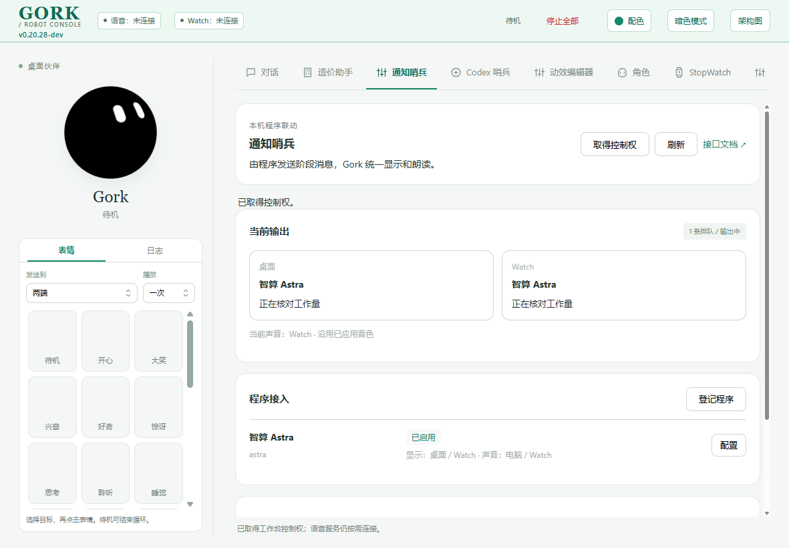
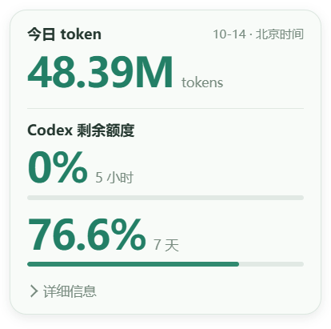
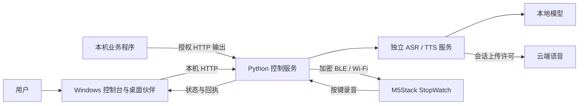

# Gork Robot Console × M5Stack StopWatch

**把桌面伙伴、语音对话、任务提醒和实体机器人放进同一个控制台。**

Gork 是面向 Windows 与 M5Stack StopWatch 的个人机器人项目：电脑端提供常驻动画角色、语音工作台和程序通知接口，Watch 通过加密蓝牙或 Wi-Fi 接收表情、文字与语音，也可用实体按键发起语音对话。本仓库同时保留桌面应用、控制服务、独立语音模块、固件工程和 Android 实验客户端，便于复现与继续开发。

[快速开始](#快速开始) · [功能](#功能) · [模块与架构](#模块与架构) · [开发与验证](#开发与验证) · [文档](#文档) · [版本记录](CHANGELOG.md)

> 项目处于开发阶段。当前电脑端源码为 **v0.20.38-dev**；功能、构建、设备写入与实际听验分别记录。运行中的版本以控制台页眉、设置页及 `/api/health` 为准。

## 界面预览

通知哨兵控制台：左侧常驻 Gork，右侧完成对话、角色编辑、设备与程序联动操作。



桌面小人的悬停卡片提供今日 token 与账号剩余额度，详细字段可展开。



以上为隔离验收截图；截图版本、任务与额度数值是当时的样例，不能作为当前运行状态或账号额度。

## 功能

| 模块 | 可以做什么 |
| --- | --- |
| 桌面伙伴 | 独立悬浮窗口、置顶与缩放、聊天气泡、角色与配色、表情预览、待机动作及鼠标跟随 |
| 对话工作台 | 文字输入、电脑录音与转写、可配置文字 AI、电脑或 Watch 朗读、显示端与声音端独立选择 |
| 动效编辑器 | 自定义表情与书写场景、参数预览、保存/另存、导入导出，以及 Watch 参数导出 |
| StopWatch 控制 | 加密 BLE 配对与重连、Wi-Fi/BLE 选路、设备表情与文字、短音、PCM/Opus 音频和实体按键对话 |
| 通知哨兵 | 本机程序独立授权，统一调度表情、文字和声音；支持幂等回执、状态续期、阶段替换、取消与人工操作优先 |
| 造价助手 | 通过本机 HTTP 复用造价智算的知识查询、任务状态和阶段通知；原版与 Astra 来源分别核对 |
| Codex 哨兵 | 可选任务观察、结束提醒和官方账号额度读取；额度展示可独立于任务哨兵使用 |
| 今日 token | 只读 CC Switch 已计数的本机 Codex 用量，并与官方账号剩余额度分开显示 |
| 界面与恢复 | Mantine/经典主题、明暗与配色切换，语音会话自动连接及断线恢复、状态日志与全局停止 |

固定提示可按当前有效音色预生成；动态文字按完整内容、音色与合成参数匹配语音缓存。云端能力使用会话许可，密钥通过指定环境变量或本机受保护配置保存。

## 当前状态

| 组件 | 当前源码 / 候选 | 验证边界 |
| --- | --- | --- |
| 控制台与 Electron | v0.20.38-dev | 已有自动回归与隔离 Electron 验收；新补丁须正常退出并重开后加载 |
| Watch 固件 | v0.11.10-dev 候选 | 最后记录的应用区写入与独立校验为 v0.11.9-dev；连接播报候选 v0.11.10 尚未写入 |
| 独立语音服务 | v0.3.3，HTTP 协议 v1 | ASR/TTS 与路由接口独立，当前单活会话；服务版本随实际加载确认 |
| Android 客户端 | v0.1.7-dev | 已有目标手机配对、基础控制与短句听验记录；后续新增功能暂停 |
| 通用输出接口 | 协议 1.0 | 本机 HTTP、来源令牌与独立输出授权；提供文档、Schema 和标准库 Python SDK |

已有实机记录涵盖表情/文字、短音、语音朗读及部分按键对话。完整的边合成、边传、边播仍在后续路线中；性能量化、资源循环、电池对照与长时间稳定性测试按用户决定延期。具体结论以对应 [验收资料](04-output/) 为准。

## 快速开始

### 1. 准备 Windows 开发环境

当前验证环境为 Windows x64、Python 3.14 和 Node.js 24+。桌面应用依赖 Electron；语音服务使用独立 Python 环境。首次安装需要网络下载依赖，仓库不包含虚拟环境、语音模型、密钥或本机配置。

在 PowerShell 中运行：

```powershell
git clone https://github.com/zgzzmnbx/Daweiba-GORKbot-on-ESP-Stopwatch.git
cd Daweiba-GORKbot-on-ESP-Stopwatch

py -3.14 -m venv Codex-Temp/.venv-companion
& 'Codex-Temp/.venv-companion/Scripts/python.exe' -m pip install -r '03-Src/stopwatch-voice-companion/requirements-lock.txt'
npm ci --prefix '03-Src/gork-desktop'
```

### 2. 配置并启动控制台

首次克隆后复制配置模板；已有本机配置时保留原文件。

```powershell
Copy-Item '03-Src/stopwatch-voice-companion/config.example.toml' '03-Src/stopwatch-voice-companion/config.local.toml'
.\start-gork-console.cmd
```

默认控制台为 `http://127.0.0.1:8766`，语音服务为 `http://127.0.0.1:8765`。启动器检查自身后台与版本，托盘提供退出入口；更新 Electron 或后端后，从托盘正常退出，再用原入口重开。

可以先体验电脑端角色与界面。在本机配置中设置 `auto_connect_device = false` 可关闭设备自动连接；设置 `voice_service_command = []` 可只复用已启动的语音服务。未配置设备、模型或回答服务时，相应能力会显示未就绪。网页入口为根目录 `start-voice-companion.cmd`。

### 3. 启用语音与 AI

语音服务源码已经包含在本仓库，运行环境与模型需要单独准备：

```powershell
py -3.14 -m venv Codex-Temp/voice-runtime/.venv
& 'Codex-Temp/voice-runtime/.venv/Scripts/python.exe' -m pip install -r '03-Src/voice-service/03-Src/requirements.lock.txt'
```

本地识别/合成使用 SenseVoice 与 Kokoro，模型目录、云端参数和指定密钥环境变量见 [语音服务说明](03-Src/voice-service/README.md)与[服务配置模板](03-Src/voice-service/03-Src/config/voice.example.toml)。默认托管入口为 `03-Src/voice-service/tools/serve_managed.py`，由 Gork 管理自己启动的服务生命周期。

文字 AI 按[控制服务配置模板](03-Src/stopwatch-voice-companion/config.example.toml)配置 OpenAI 兼容的文字回答地址、模型及密钥环境变量。录音上传、TTS 文字上传和 AI 文字发送是独立许可；在界面核对路由、音色与许可后应用。配置密钥本身不会启动录音或自动发送问题。

### 4. 连接 StopWatch

首次 BLE 连接，在设备 Bluetooth 设置中打开 BLE 和 Pair 窗口，再由 Gork 扫描、选择设备并完成配对。已绑定后日常重连无需反复打开 Pair。Wi-Fi 配网与连接策略见 [Wi-Fi/BLE 与 Watch 对话说明](00-docs/00-PRD/34-WiFi与BLE自动切换及Watch语音对话PRD-v1.0.0-【codex】.md)。

当前固件使用单可信控制端；手机与电脑换绑会影响另一端。设备型号、Flash 分区与实际端口须在操作前核对，设备写入与整片恢复须单独授权。StopWatch v1.0 部分批次的 `BAT` 标记实际为 `5V IN`，确认硬件版本前不要接外部锂电池。详细构建与恢复入口见 [固件工程](03-Src/stopwatch-grok-avatar/README.zh-CN.md)。

## 模块与架构



| 目录 | 内容 |
| --- | --- |
| `03-Src/gork-desktop/` | Electron 外壳、悬浮小人、气泡/悬停卡片及窗口生命周期 |
| `03-Src/stopwatch-voice-companion/` | Python 控制服务、网页控制台、网络/语音/通知适配 |
| `03-Src/voice-service/` | 可独立复用的 ASR/TTS HTTP 服务与测试 |
| `03-Src/stopwatch-grok-avatar/` | Arduino/PlatformIO 固件、渲染、音频、BLE 与网络协议 |
| `03-Src/gork-android/` | Android 实验客户端 |
| `03-Src/avatar-library/`、`01-assets/` | 固定来源快照、角色与设计资料 |
| `00-docs/` | PRD、当前计划、接口文档与交接契约 |
| `04-output/` | 版本化固件候选、截图和实施/验收资料 |
| `tools/` | 导出、验证、诊断与维护工具 |
| `Codex-Temp/` | 本机环境、模型、缓存和临时证据，Git 忽略 |

## 程序接入

在「通知哨兵 → 程序接入」登记来源，选择显示端、声音端与优先级，再显式启用。调用端使用自己的令牌向 `/api/external` 发送表情、文字或语音请求，并查询最终回执。状态通知支持心跳续期，阶段推进使用新的事件和递增序号；业务阶段映射由调用程序负责。

接入完整示例、取消语义和安全边界见 [通用输出接口 v1.0.0](00-docs/接口/Gork机器人通用输出接口-v1.0.0-【codex】.md)。[Python SDK](03-Src/stopwatch-voice-companion/companion/external_client.py)只依赖标准库。HTTP `202` 表示已入队，设备 `played` 表示设备报告播放完成，实际可闻仍须听验确认。

## 开发与验证

控制台的权威模板是 `ui/console.html`。修改模板或组件后运行构建，提交生成的本地 HTML/CSS；主题切换共用原控制器与 DOM。

```powershell
npm ci --prefix '03-Src/stopwatch-voice-companion'
npm run build:ui --prefix '03-Src/stopwatch-voice-companion'
npm run check:ui --prefix '03-Src/stopwatch-voice-companion'
npm test --prefix '03-Src/stopwatch-voice-companion'
npm test --prefix '03-Src/gork-desktop'

$env:PYTHONPATH = '03-Src/stopwatch-voice-companion'
& 'Codex-Temp/.venv-companion/Scripts/python.exe' -m pytest '03-Src/stopwatch-voice-companion/tests' -q
```

固件使用 PlatformIO Core 6.1.18，平台与库提交锁定在 [platformio.ini](03-Src/stopwatch-grok-avatar/platformio.ini)。构建命令为 `pio run -d 03-Src/stopwatch-grok-avatar`；本机 Windows 路径兼容方法、板卡参数和实际构建记录见固件说明。构建不会替代设备写入或真机验收。

测试默认使用隔离状态目录与替身服务。真实语音、云调用、BLE/Wi-Fi、设备写入和长稳验证分别记录；不要通过启动正式实例来替代隔离回归，也不要在 Issue 或提交中附带密钥、私人录音、完整 Flash 恢复镜像或本机状态数据库。

## 文档

- [控制台与电脑端使用](03-Src/stopwatch-voice-companion/README.md)
- [Electron 桌面应用](03-Src/gork-desktop/README.md)
- [固件工程与硬件](03-Src/stopwatch-grok-avatar/README.zh-CN.md)
- [Android 客户端](03-Src/gork-android/README.md)
- [语音模块](03-Src/voice-service/README.md)
- [当前版本计划](00-docs/00-PRD/02-当前版本计划.md)
- [任务与验收资料](04-output/)
- [最近五版 CHANGELOG](CHANGELOG.md)与[完整历史归档](CHANGELOG-历史归档.md#readme-history-20261014)

## 来源与许可

仓库包含多种来源与许可，不能把整个工程统一视为 MIT：

- 固件底座来自 [Trentct/m5stack-stopwatch-avatar](https://github.com/Trentct/m5stack-stopwatch-avatar)，许可文本见[固件 LICENSE](03-Src/stopwatch-grok-avatar/LICENSE)。
- Grok bot 及角色几何来自固定提交的 [Bible Strong Avatar Lab](https://github.com/smontlouis/bible-strong-avatar-lab)，保留[来源说明](03-Src/avatar-library/README.md)和[AGPL 许可](03-Src/avatar-library/LICENSE)。
- 动效模块保留[上游许可](03-Src/stopwatch-voice-companion/static/motion/LICENSE.upstream)与[笔型参考](03-Src/stopwatch-voice-companion/static/motion/PEN-REFERENCES.md)。
- Mantine 的本地样式保留[MIT 许可](03-Src/stopwatch-voice-companion/static/mantine/LICENSE)；CC Switch 计数适配保留[来源与 MIT 声明](03-Src/stopwatch-voice-companion/CC_SWITCH_NOTICE.md)。
- M5Stack 库、Opus 依赖、历史几何研究及连接播报素材见[第三方声明](03-Src/stopwatch-grok-avatar/THIRD_PARTY_NOTICES.md)。各子模块与素材的来源声明分别适用。

本项目以个人实验与复现为当前使用场景。Gork 为本项目名称；第三方角色参考与服务接入不代表与其作者或品牌存在官方合作。

## 反馈与参与

维护者：[zgzzmnbx](https://github.com/zgzzmnbx)。问题、建议与复现步骤可提交到 [GitHub Issues](https://github.com/zgzzmnbx/Daweiba-GORKbot-on-ESP-Stopwatch/issues)。请说明组件版本、操作系统/设备型号、预期和实际结果，并提供去除敏感内容后的日志。

提交修改前先阅读 [项目协作规则](AGENTS.md)，保持模块边界，并附与改动相关的测试或验收证据。版本变化写入 CHANGELOG，README 保持项目介绍与使用入口；后续计划与未完成项放入当前版本计划。
